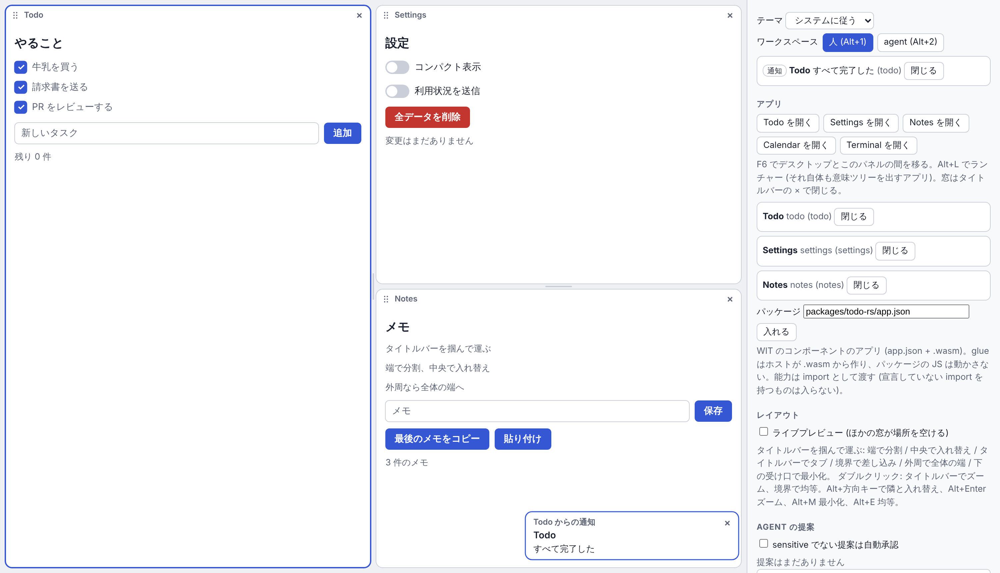
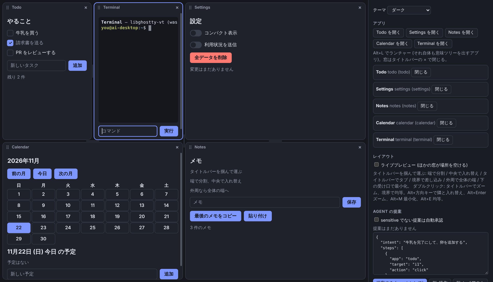
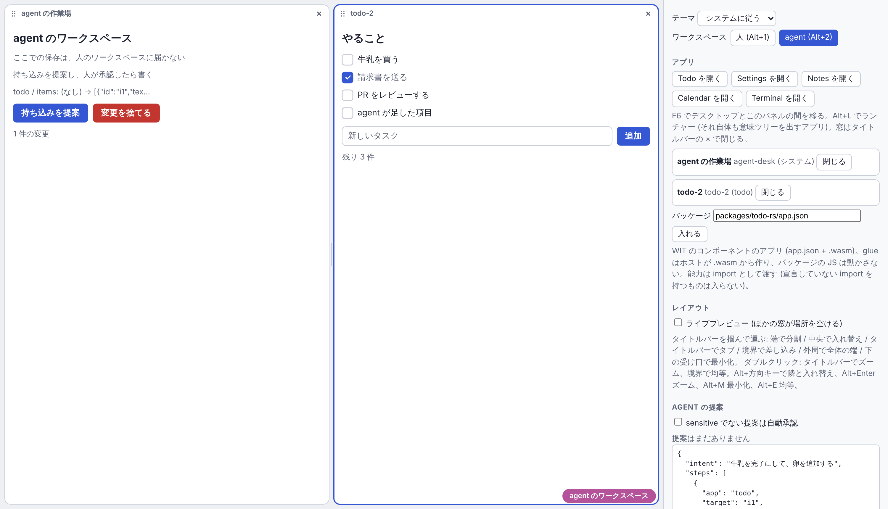
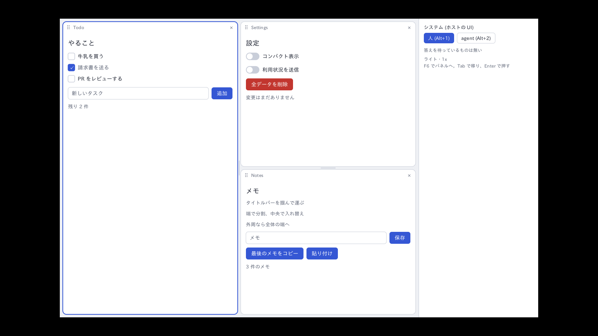

# GUI プラットフォームとしての構成

試作 (`proto-canvas/`) を「アプリを載せて広げていける GUI プラットフォーム」にするための構成。
[PROTOCOL.md](./PROTOCOL.md) がアプリと shell の間のワイヤ形式で、ここはその外側 (アプリの入れ方・権限・システムのサービス・描画の差し替え・永続化) を決める。

## 層

```
┌ ホストの UI (信頼できる面) ──────────────────────────────────────────────┐
│  許可の要求 / 通知 / 提案の承認 / アプリの起動と終了                       │  ← アプリからは描けない
└──────────────────────────────────────────────────────────────────────────┘
┌ Platform (src/platform/) ───────────────────────────────────────────────┐
│  createPlatform: 組み立ての起点 (DOM に依存しない)                         │
│  AppRegistry   : インストール済みのアプリ (manifest)。窓の工場            │
│  ServiceHost   : 能力の確認 → サービス (storage / clipboard / 通知 /       │
│                  アプリの起動 / 擬似端末)。すべて監査ログに残る            │
│  Session       : 開いている窓・分割ツリー・ドック・ズームの保存と復元      │
└──────────────────────────────────────────────────────────────────────────┘
┌ Shell (src/shell.ts) ───────────────────────────────────────────────────┐
│  意味ツリー (P1) / 意味的な入力 (P2) / template とキャッシュ (P3) /        │
│  タイル (launch・close を含む LayoutOp) / 提案 → プレビュー → 承認         │
└──────────────────────────────────────────────────────────────────────────┘
┌ 描画 backend (src/backend/) ────────────────────────────────────────────┐
│  display list (P4b) → Canvas 2D │ Odin (CPU) │ Odin + wgpu (主)            │
│  ARIA のミラー DOM (a11y) / IME (P5)                                       │
│  ネイティブ: native/renderer (SDL3 + wgpu-native) に標準入出力で送る         │
└──────────────────────────────────────────────────────────────────────────┘
```

## アプリのモデル

アプリは **manifest** で宣言し、`AppRegistry` に入れる (`src/platform/types.ts`)。

```ts
interface AppManifest {
  id: string;                 // アプリの id。最初の窓の id にもなる (2 枚目以降は id-2, id-3 ...)
  title: string;
  description: string;
  kind: 'js' | 'component' | 'legacy';  // TypeScript / WIT の wasm コンポーネント / AT-SPI の既存アプリ
  capabilities: Capability[]; // 使いたい能力。宣言していない能力は尋ねることもできない
  multiInstance: boolean;     // 複数の窓で開けるか
  system?: boolean;           // ランチャーなど。一覧に出さない
  create(windowId: string, services: AppServices): App;
}
```

- アプリは **意味ツリーを出すだけ** (P1)。見た目は shell が template から決める。ランチャーもこの形の普通のアプリ (`src/apps/launcher.ts`)
- 窓の id は registry が決め、アプリはそれを使う (`app.id === windowId` を registry が確かめる)
- `create` に渡す `services` は窓ごとに作る。どの呼び出しも `(アプリ, 窓, 能力, 操作, 結果)` で監査ログに残る
- 窓の起動と終了も `LayoutOp` (`launch` / `close`) で、人の操作と agent の提案が同じ経路を通る。`close` は作業中の状態を失いうるので、自動承認しない

## 能力 (capability) と許可

| 能力 | 既定 | 内容 |
|---|---|---|
| `storage` | 許可 | アプリ自身の保存領域 (同じアプリの窓で共有。キーは `app.<id>.<key>`) |
| `clipboard.write` | 許可 | クリップボードに書く |
| `clipboard.read` | 尋ねる | ほかのアプリが書いたものを読めるので、尋ねる |
| `notifications` | 尋ねる | 通知を出す |
| `apps.launch` | 尋ねる (システムのアプリは許可) | ほかのアプリを開く |
| `terminal.pty` | 尋ねる | ホストの本物のシェル。ホストが擬似端末の橋を用意しているときだけ使える |
| `data:<topic>` | 尋ねる (いつも) | ほかのアプリが提供するデータを読む (例: `data:calendar.events`)。下の「アプリどうしのデータ」 |

- 状態は `granted` / `denied` / `ask`。`ask` の能力を使うと、呼び出しは `pending` で返り、ホストの UI に許可の要求が出る
- **許可の要求に答えられるのは人だけ** (`answer(id, granted, 'human')`)。agent の答えは拒否する。MCP にも答える tool は無い
- 答えは保存され、次の起動でも効く。アプリには `onGrant` で知らせる (アプリは「もう一度押して」と出すなど)
- 許可の要求・通知は **アプリから描けない面 (ホストの UI)** に出す。アプリの template は窓の中にしか描けないので、許可のダイアログを偽装できない。スクリーンリーダーには `aria-live` で読み上げる
- 通知は Canvas の上にも出す。shell が窓より上の層 (display list の最後) に描くので、窓の中に切られたアプリの描画は届かない。出どころ (「Todo からの通知」) はプラットフォームが manifest の名前で付け、アプリは自分の名前を偽れない
  - 右下 (ドックと札の上) に、新しいものを下にして 3 件まで。6 秒で画面から消える (パネルの一覧には残る)。消える時刻には `Frame.wakeAt` で起こすので、出ている間フレームを回し続けない
  - × で閉じる。本文を押すと出した窓を表に出して (ドック・裏のタブ・ほかの窓のズーム) フォーカスし、閉じる。Escape は出ている通知の新しいものから閉じる。どれも人の入力だけで、agent の口には無い
  - 2 つのワークスペースのどちらを見ていても出る (最初に出した時刻を共有し、切り替えで出し直さない)
  - 許可の要求は今まで通りホストの UI だけに出す (Canvas の上で答えさせると、押す場所を窓の中身に重ねて誘う余地が増えるので)



WIT にするときは、能力ごとに interface を分け、manifest の宣言に合わせてホストが import を与える (与えない import は link できない)。今の `component/wit/app.wit` は `host.emit` だけなので、そこに optional な import として足していく。

## アプリのパッケージ (WIT のコンポーネント)

あとから入れるアプリは、`app.json` と WIT のコンポーネント (`.wasm`) の組 (`proto-canvas/packages/todo-rs/`)。**パッケージは JS を持たない**。

```json
{ "id": "todo-rs", "title": "Todo (Rust)", "kind": "component", "capabilities": ["storage"],
  "multiInstance": false, "component": "todo.wasm" }
```

- **能力 = import**。ホストは、宣言した能力の WIT の interface だけを import として渡す。`storage.get` は `result<option<string>, string>`: 読めないとき (人が拒否している) は err、キーが無いだけなら ok(none)。この 2 つを分けないと、読めなかったアプリが既定の値で保存済みのデータを上書きしてしまう (Rust の Todo は、読めていない窓では書かない)。`storage` を宣言したアプリにだけ `gui:app/storage` (`component/wit/app.wit` の world `gui-app-storage`) を渡し、その呼び出しは JS のアプリと同じサービス (許可・監査ログ) を通る
- **glue はホストが作る**: コンポーネントを JS から呼ぶためのコード (glue) は、ホストが jco の `generate` (それ自体が wasm で動く) で `.wasm` から生成し、Blob の URL で読み込む。パッケージの JS がページの中で動くことはない
- **宣言していない import を持つコンポーネントは入れない**: import の一覧は glue の生成で分かる (コンポーネントの型そのもの)。何が足りないかを言う (「gui:app/storage を import している (能力 storage を宣言していない)」)
- WASI は渡すが、ファイルは 1 つも開いていない (preopens なし)。Rust の std が WASI を持ち込んでも、ファイルには触れない
- `app.json` の検査: パッケージの外を指すパス、知らない能力、形の崩れを断る。入っているアプリ (同梱を含む) と同じ id は入れない (なりすまし)。world `gui-app` の `app` (start / on-action) を export していないものも入れない
- 起動時に読むパッケージの一覧が壊れていても、後から同じ id を返すようになったパッケージがあっても、起動は止めない (読み飛ばして console に残す)
- 入れるのは人だけ (パネルの「パッケージ」)。agent と MCP には口が無い。入れた URL は保存し、次の起動ではセッションの復元の前に読み込む
- パッケージの JS を動かさないので、**ほかの origin のパッケージも入れられる** (CORS が要る。fetch は資格情報を送らない)。http(s) 以外の URL は断る
- 読み込みには期限がある (1 ファイル 10 秒。接続から本文を読み終えるまで)。応答しないサーバで起動が止まらない
- **コンポーネントは Worker で動く** (1 つの窓に 1 つ。`src/platform/worker-runner.ts`、`component-worker.ts`)。メインスレッドは応答を待つだけで、起動 (5 秒) と操作 (2 秒) の期限までに返らなければ Worker ごと止める。止めた窓は「応答しない」と理由を出し、「再起動」で新しい Worker から始め直す (状態は保存領域から読み直す)。ほかの窓とデスクトップは固まらない。入れる前の export の検査も Worker で、期限付きで行う
  - 能力の import は同期で答える必要があるので、storage は「許可の状態とデータの写し」を Worker に持たせる。読み書きはメインスレッドにも知らせ、監査ログ・許可の要求・保存はメインで行う。人が許可を変えたら写しも変える。同じアプリのほかの窓には書き込みを知らせる
  - 起動中に読み込むパッケージを記録し、起動が終わらなかったら次の起動で隔離する仕組みと、`?safe` は残した (glue の生成はメインスレッドで動くため)
  - 人のフォーカスは shell が先に動かす。Worker の返事を待たずに打った文字も、その入力欄に届く (アプリが返す木のフォーカスが正なので、アプリが別の場所へ回せばそちらが勝つ)
  - Worker の中の storage の写しは Map (キーは任意の文字列。`__proto__` や `constructor` もただのキー)
- 残る前提: glue の生成器 (jco) を信頼している。生成器は 5.7MB の wasm で、最初にパッケージを読むときだけ読み込む。生成した glue は `eval` ではなく ES module として読むので、CSP で `blob:` の script を許す必要がある

## アプリどうしのデータ

共有の保存領域は作らない。データを持つアプリが**提供するもの**を manifest で宣言し、読みたいアプリは**能力**として宣言する (Android の ContentProvider に近いが、読み取りだけ)。

```ts
// 提供する側 (Calendar)
provides: { 'calendar.events': { description: '月の予定 (日付と題名。読み取りだけ)' } },
provide: (topic, args, services) => calendarEvents(services, args),   // services は Calendar 自身の能力付きのサービス

// 読む側 (Terminal)
capabilities: [..., 'data:calendar.events'],
services.data.query('calendar.events', { year, month })               // 初めては pending → 人が許可 → 値
```

- 提供は manifest の関数なので、提供する側の窓が開いていなくても答えられる。提供する側は自分の保存領域だけを読み、読む側の保存領域には触れない
- 読む側の能力はいつも「尋ねる」から始まる。許可の要求には、提供するアプリと中身 (「Calendar の『月の予定』の読み取り」) が出る。答えられるのは人だけ
- 宣言していないアプリは尋ねることもできない (`undeclared`)。提供するアプリが無ければ `unavailable`
- 監査ログには `query calendar.events from calendar` のように、誰のデータを読んだかが残る
- 引数と答えは `structuredClone` で渡す (参照を共有しない)。WIT にするときは、提供する側を `export`、読む側を能力付きの `import` にする

## 描画 backend

display list (P4b) が backend の境界。`DrawOp` は `rect` / `text` / `clip` / `layer` / `pop` だけ。

- 色は token (`bg` / `text` / `accent` ...) が基本。`rgb` はアプリの中身 (ターミナルの画面のような、アプリが色を持つ内容) にだけ使い、shell の UI (提案の枠・承認・タイトルバー) は token だけで描く
- `mono` は等幅で描く指定。ターミナルは格子に 1 桁ずつ置くので、フォントの字幅には頼らない
- backend は Canvas 2D (既定)、Odin のソフトウェア描画、Odin + wgpu (主。[DECISIONS.md](./DECISIONS.md))。3 つとも `rgb` を受ける

## 永続化

`KeyValue` (文字列の get / set) 1 つにまとめる。ブラウザでは localStorage (`ai-native-desktop.kv.*`)。

| キー | 中身 |
|---|---|
| `platform.grants` | アプリごとの能力の状態 |
| `platform.session` | 開いている窓 (窓の id → アプリ)、分割ツリー、ドック、ズーム |
| `app.<id>.<key>` | アプリの保存領域 |

セッションは、窓のアプリがすべてインストール済みで、木とドックの窓が一致するときだけ復元する。壊れていれば捨てて初期の窓で起動する。`?session=off` で復元しない。

## アプリの例: Terminal (libghostty-vt)

`src/apps/terminal/`。プラットフォームの上に「普通のアプリ」として載せた例。

```
キー入力 / IME ─▶ textbox (sensitive) ─Enter (click)─▶ 内蔵シェル ──ANSI──┐
                                                    │ または             ▼
                                        terminal.pty ─▶ ホストの bash ─▶ libghostty-vt (wasm)
                                                                         │ 画面の cell
                                       意味ツリー: log ノード ◀───────────┘
                                         value  = 画面の文字 (agent・スクリーンリーダー)
                                         screen = 色付きの格子 (描画用。agent には渡さない)
```

- 端末の状態機械 (VT のパース・画面・色・カーソル・スクロールバック) は **libghostty-vt** の wasm。npm の `ghostty-web` (MIT) が同梱する `ghostty-vt.wasm` を自分で instantiate する。ghostty-web の DOM の端末 (xterm.js 互換の部分) は使わない
- 画面は意味ツリーの `log` ノード (ARIA の log) にする。文字は `value`、描画用の色付きの格子は `screen`。描画は shell の `terminal` widget が格子に 1 桁ずつ置く
- コマンド行は `sensitive`: agent の入力は毎回、人の承認が要る。承認された入力は `whoami` で `agent` と出る (actor がアプリまで届く)
- 既定は内蔵の小さなシェル (`help` / `echo` / `colors` / `ls` / `cat` / `write` / `copy` / `paste` / `notify` / `open` / `whoami` ...)。ファイルは storage、copy / paste はクリップボード、`open` はアプリの起動で、どれも能力の確認を通る
- `?pty=ws://127.0.0.1:8140/?token=...` で、ホストの擬似端末の橋 (`pty/server.ts`) につなげる。橋は Python の標準ライブラリの `pty` で擬似端末を作るので、ネイティブ拡張は要らない。127.0.0.1 だけで待ち、起動ごとの token と Origin を確かめる
- 端末の大きさは窓に合わせる。shell が P2' (`onResize(node, cols, rows)`) で格子の大きさを知らせ、アプリは libghostty-vt の端末と、ホストの擬似端末 (TIOCSWINSZ。シェルには SIGWINCH が届く) の両方を変える。擬似端末の橋は Python の標準ライブラリの `pty` を使う (`pty/pty_helper.py`。Node だけでは ioctl を呼べない)
- agent とスクリーンリーダーに渡す文字 (`value`) は、折り返した行を 1 行につなげる (論理的な行)。描画の格子は行ごと
- ghostty-web 0.4.0 の `isRowWrapped(y)` は、d.ts の説明 (「次の行へ折り返す」) と違い、「y 行目が前の行の続き」のとき true を返す (実測)。`vt.ts` はこの意味で使う

### 見つけた問題

ghostty-web 0.4.0 の wasm は、別の端末を `free()` したあとのメモリを 0 で埋めずに新しい端末の画面に使う。そのままだと空の cell にごみの文字 (前の端末のポインタの値) が出る。作った直後に画面を消去 (ED 2: `ESC [ 2 J`) してすべての cell を書かせると直る (`vt.ts`、テストあり)。

## アプリの例: Calendar

`src/apps/calendar.ts`。月の表を ARIA の `table` / `row` / `columnheader` / `cell` で出す。


- 日のセルは `click` で選ぶ (`selected`)。予定のある日は「•」が付く。選んだ日の予定は `list`、追加は textbox (Enter でも追加)
- 予定は storage、今日の予定があれば開いたときに通知する (notifications)。予定の削除は `sensitive` で、agent からは毎回承認が要る。追加は sensitive でないので、自動承認の対象にできる
- 表の列を揃えるため、box に `equal` (horizontal の子を等幅にする。CSS の `flex: 1 1 0`) を足し、既定レンダラの `row` に使った。等幅の行に広げられたボタンは幅いっぱいに描き、文字は中央に置く。veriss へは `flex: 1 0 0; min-width: <固有幅>` として写す
- ターミナルの内蔵シェルの `cal` は、カレンダーの予定を `data:calendar.events` で読み、予定のある日に印を付けて一覧を出す (上の「アプリどうしのデータ」)

## テーマ (ライト / ダーク)

- 配色の正は `src/theme.ts` (`THEMES.light` / `THEMES.dark`)。`www/index.html` の CSS 変数は同じ値で、テストが一致を確かめる
- パネルの「テーマ」で、システムに従う / ライト / ダークを選ぶ (`<html data-theme>`、`platform.theme` に保存)。Canvas の backend は CSS 変数を読み直して描く。Odin の backend も同じ色を受け取る
- **veriss でのコントラスト検査**: lowering は色を token で出し、ダークの値を `@media (prefers-color-scheme: dark)` の色の宣言として複製する。veriss はダークの規則があるとき、同じ配置のままダークでもコントラスト (WCAG AA) を検査する
  - Todo / Settings / Notes / ランチャー / Terminal は、view を丸ごと veriss に通す (配置・操作対象の大きさ・名前・ライトとダークのコントラスト)
  - Calendar の表は、a11y と縦方向の検査を同時にすると veriss の時間が数分を超える (mizchi/veriss#12 と同じ傾向)。そこで配置は integrity で証明し、コントラストは「色の組の見本」で検査する
  - **色の組の見本** (`contrastSpecimen`): 文字のコントラストは (文字色, 背景色, 大きさ, 太さ) だけで決まる。lowering が使った組をすべて返すので、全アプリの組と shell 自身の UI の組 (`CHROME_PAIRS`: タイトルバー、ズームの札、提案の番号など) を 1 枚のページに並べ、ライトとダークで veriss に通す
  - ダークだけ崩した配色 (補足の文字を枠線の色にする) は、ダークのコントラスト違反として見つかることも確かめている
- ターミナルの画面の色 (ANSI の色) はアプリの中身なので、検査の対象外。既定の文字色と背景色だけはテーマによらず暗い配色で固定している



## ワークスペース (人 / agent)

人のワークスペースのほかに、agent が提案なしで動かせる **agent のワークスペース** を持つ。agent の結果は、人が承認したときだけ人のワークスペースに持ち込む。

```
agent ──直接操作──▶ agent のワークスペース (Shell)       人のワークスペース (Shell) ◀── 人
                      │ storage.set                           ▲ storage.onChange で読み直す
                      ▼                                       │
                 重ねた層 (copy-on-write) ── 持ち込みの提案 ──▶ 人が承認 ──▶ 本物の保存領域
```

- 2 つの Shell (`platform.shell` / `platform.agentShell`)。窓の id は 2 つを通して重ならない。Alt+1 / Alt+2 (パネルのボタンでも) で人が見る方を切り替える。agent のワークスペースの右下には札が出る
- agent のワークスペースでは、agent は**提案なしで**操作できる (`policy.agentDirect`)。ただし `sensitive` なノードは今まで通り承認が要り、`focus` は使わない
- 保存領域の書き込みは、本物ではなく**重ねた層** (`app.<id>.<key>` → 値) に溜まる。読むときは層 → 本物の順。人のワークスペースの窓には何も届かない
- 外へ出る能力 (クリップボード・通知・アプリの起動・ホストのシェル) は、agent のワークスペースでは拒否する (監査ログに「agent のワークスペース」と残る)。人の目に触れる前に外へ漏れないように
- システムのアプリ「agent の作業場」が、溜まった変更 (アプリ / キー: 前 → 後) を出す。「持ち込みを提案」で、変更の一覧を持ち込みの要求 (`MergeRequest`) にする
- **持ち込みに答えられるのは人だけ** (パネルの承認 / 却下)。承認すると本物に書き、監査ログに `merge <key> (<id>)` を残し、人の窓のアプリは `storage.onChange` で読み直す (Todo / Notes / Calendar。パッケージのコンポーネントは Worker を作り直す)
- 本物が、agent が層に書き始めた時点の値から変わっていれば、承認しても書かない (`stale`)。提案の前でも後でも、人の変更を上書きしない
- 提案のあとに agent がさらに書いた分は、承認しても消さずに層に残し、次の持ち込みに出す
- 人は重ねた層を捨てられる (agent は捨てられない)。捨てると agent の窓も読み直し (捨てた中身を次の保存で層に戻さない)、待っている持ち込みは却下になる
- パネルの持ち込みの要求は、値の全文 (前 / 後) を開いて確かめられる
- 重ねた層と agent のワークスペースはセッションに残さない (起動ごとに空から)
- MCP: `workspace_get_tree` / `workspace_launch` / `workspace_act` / `propose_merge` / `wait_merge`。持ち込みを承認する tool は無い
- 他のアプリのデータ (`data:<topic>`) は読み取りだけなので、agent のワークスペースでも人と同じ確認で読める (提供する側は本物の保存領域を読む)



## ネイティブのホスト

ブラウザを使わず、デスクトップのアプリとして動かす (`proto-canvas/native/`)。`createPlatform` と shell は DOM に依存しないので、ブラウザの `main.ts` の代わりに Node のホストが同じものを組み立てる。描画は Odin の描画プロセスに任せる。

```
┌ Node のホスト (native/host.ts) ─────────────────────┐        ┌ 描画プロセス (native/renderer, Odin) ─────┐
│ createPlatform / shell / 文字の計測 (mizchi/font)    │ 描画命令 │ backend-odin-gpu (ブラウザと同じコード)    │
│ 保存: JSON ファイル (KeyValue)                       │ ──────▶ │ → wgpu-native (Vulkan / Metal / DX12)     │
│ 擬似端末: pty_helper.py を直接                        │ 標準入力 │ SDL3 の窓・マウス・キー・文字入力 (IME)    │
│ 人だけが答えるパネル (許可・提案・持ち込み)           │ ◀────── │ 窓なし: オフスクリーンに描き PNG に書く   │
│ MCP: connectMcp (ブラウザと同じ)                      │ 入力     └───────────────────────────────────────────┘
└──────────────────────────────────────────────────────┘ (JSON Lines)
```

- 2 つのプロセスに分けた理由は [DECISIONS.md](./DECISIONS.md) (2026-11-23)。TypeScript の shell とプラットフォームはそのまま使い、Odin は描画と OS の窓だけを受け持つ
- **通信**: ホスト → 描画は `[u32 長さ][種類][中身]` の繰り返し (`native/wire.ts`)。描画命令 (P4b の DrawOp) は色 token を RGBA に解決して送り、座標は論理ピクセルのまま (拡大率は描画側が掛ける)。描画 → ホストは JSON Lines (`ready` / `size` / `down` / `key` / `text` / `preedit` / `frame` ...)
- 1 フレームずつ送り、描画プロセスの `frame` の返事を待ってから次を送る (溜めない)。通知が消える時刻などは `Frame.wakeAt` で起きる
- **入力**: SDL3 の scancode を、ブラウザの `KeyboardEvent.code` と同じ名前にして送る。キーの対応 (Alt + 方向キーなど) はブラウザと共通の `src/backend/keys.ts`。文字は SDL3 の文字入力 (`TEXT_INPUT` → `ime-commit`、`TEXT_EDITING` → `ime-preedit`) で、shell が入力欄にフォーカスしたとき (`ime-enable`) だけ始める。キャレットの位置を `SetTextInputArea` に渡し、IME の候補窓をそこに出す
- **人だけが答えるパネル**: ブラウザでは DOM のパネルが受け持つ口 (許可の要求・AI の提案・持ち込み) を、ホストが自分で描く (`native/panel.ts`)。shell に渡す幅の外 (右端 320px) に、shell の描画命令のあとで描くので、アプリはここに描けない。色の組は veriss の見本 (`CHROME_PAIRS`) に入れた
  - いつも出す (窓の最小の幅は 720px、窓なしでもそれより狭い大きさは断る)。縦に収まらなければスクロールする
  - 押す場所の判定は、描画プロセスが**表示したフレーム**のボタンで行う。表示されてから 0.5 秒たっていないボタンは押せない (カードが差し込まれて、見ていたボタンの位置に別の承認ボタンが来た直後の押し間違い・誘導を防ぐ)
  - キーボード: F6 でパネルへ移り、Tab / Enter で答える。フォーカスはボタンの action に付くので、並びが変わっても別のボタンへ移らない。見える位置まで送ってから押せる
  - 提案の手順と持ち込みの変更は、省略せずにすべて出す (承認する前に、実行されるものを全部見られる)
- **保存**: `KeyValue` は 1 つの JSON ファイル (`~/.local/share/ai-native-desktop/kv.json`、`--kv` で変える)。一時ファイルに書いてから rename し、済んでから手元の値を変える。1 つのファイルを使うホストは 1 つだけ (`<file>.lock`)。テンプレートのキャッシュも同じファイルに入る
- **擬似端末**: ブラウザでは WebSocket の橋 (`pty/server.ts`) を通すが、ネイティブでは同じ `pty_helper.py` を直接起こす (`--pty` のときだけ。許可はパネルで答える)
- **MCP**: `--mcp ws://...` で、ブラウザと同じ `connectMcp` を使う (Node 24 の WebSocket)。AI の提案と持ち込みは、ホストのパネルで人が承認する
- 窓なし (`--headless 1280x800`) では描画プロセスがオフスクリーンに描き、`--control` の標準入力から入力を入れて PNG に書き出せる (テスト・CI 用)
- まだ無いもの: パッケージ (WIT のコンポーネント) の読み込み (ブラウザの Worker の代わりに worker_threads が要る)、スクリーンリーダー (ブラウザの ARIA のミラーの代わりに、AT-SPI / NSAccessibility へ写す必要がある)、文字の太さ (フォントは 1 つ)



## 広げていく順番

0. ~~**アプリどうしのデータの受け渡し**~~ (済: provides と `data:<topic>`。書き込みや「この予定をカレンダーに追加」のような依頼は、まだ無い)
1. ~~**アプリの入れ方を増やす**~~ (済: `app.json` + WIT のコンポーネント。能力 = import。glue はホストが `.wasm` から作る)
2. ~~**窓の大きさの通知**~~ (済: P2' の格子の大きさ)
3. ~~**ワークスペース**~~ (済: agent のワークスペースと重ねた層、人が承認する持ち込み。持ち込みはキー単位で、一部だけ選ぶことはまだできない)
4. ~~**通知を Canvas の上に**~~ (済: shell の最上の層。許可の要求はホストの UI のまま)
5. ~~**ネイティブのホスト**~~ (済: Node のホスト + Odin の描画プロセス (SDL3 + wgpu-native)。KeyValue はファイル、擬似端末は直接)
6. **ネイティブでのパッケージとスクリーンリーダー**: WIT のコンポーネントを worker_threads で動かす。意味ツリーを AT-SPI (Linux) / NSAccessibility (mac) に写す
