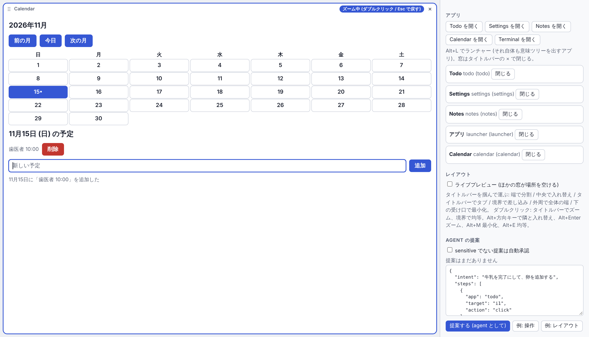

# GUI プラットフォームとしての構成

試作 (`proto-canvas/`) を「アプリを載せて広げていける GUI プラットフォーム」にするための構成。
[PROTOCOL.md](./PROTOCOL.md) がアプリと shell の間のワイヤ形式で、ここはその外側 (アプリの入れ方・権限・システムのサービス・描画の差し替え・永続化) を決める。

## 層

```
┌ ホストの UI (信頼できる面) ──────────────────────────────────────────────┐
│  許可の要求 / 通知 / 提案の承認 / アプリの起動と終了                       │  ← アプリからは描けない
└──────────────────────────────────────────────────────────────────────────┘
┌ Platform (src/platform/) ───────────────────────────────────────────────┐
│  createPlatform: 組み立ての起点 (DOM に依存しない)                         │
│  AppRegistry   : インストール済みのアプリ (manifest)。窓の工場            │
│  ServiceHost   : 能力の確認 → サービス (storage / clipboard / 通知 /       │
│                  アプリの起動 / 擬似端末)。すべて監査ログに残る            │
│  Session       : 開いている窓・分割ツリー・ドック・ズームの保存と復元      │
└──────────────────────────────────────────────────────────────────────────┘
┌ Shell (src/shell.ts) ───────────────────────────────────────────────────┐
│  意味ツリー (P1) / 意味的な入力 (P2) / template とキャッシュ (P3) /        │
│  タイル (launch・close を含む LayoutOp) / 提案 → プレビュー → 承認         │
└──────────────────────────────────────────────────────────────────────────┘
┌ 描画 backend (src/backend/) ────────────────────────────────────────────┐
│  display list (P4b) → Canvas 2D │ Odin (CPU) │ Odin + wgpu (主)            │
│  ARIA のミラー DOM (a11y) / IME (P5)                                       │
└──────────────────────────────────────────────────────────────────────────┘
```

## アプリのモデル

アプリは **manifest** で宣言し、`AppRegistry` に入れる (`src/platform/types.ts`)。

```ts
interface AppManifest {
  id: string;                 // アプリの id。最初の窓の id にもなる (2 枚目以降は id-2, id-3 ...)
  title: string;
  description: string;
  kind: 'js' | 'component' | 'legacy';  // TypeScript / WIT の wasm コンポーネント / AT-SPI の既存アプリ
  capabilities: Capability[]; // 使いたい能力。宣言していない能力は尋ねることもできない
  multiInstance: boolean;     // 複数の窓で開けるか
  system?: boolean;           // ランチャーなど。一覧に出さない
  create(windowId: string, services: AppServices): App;
}
```

- アプリは **意味ツリーを出すだけ** (P1)。見た目は shell が template から決める。ランチャーもこの形の普通のアプリ (`src/apps/launcher.ts`)
- 窓の id は registry が決め、アプリはそれを使う (`app.id === windowId` を registry が確かめる)
- `create` に渡す `services` は窓ごとに作る。どの呼び出しも `(アプリ, 窓, 能力, 操作, 結果)` で監査ログに残る
- 窓の起動と終了も `LayoutOp` (`launch` / `close`) で、人の操作と agent の提案が同じ経路を通る。`close` は作業中の状態を失いうるので、自動承認しない

## 能力 (capability) と許可

| 能力 | 既定 | 内容 |
|---|---|---|
| `storage` | 許可 | アプリ自身の保存領域 (同じアプリの窓で共有。キーは `app.<id>.<key>`) |
| `clipboard.write` | 許可 | クリップボードに書く |
| `clipboard.read` | 尋ねる | ほかのアプリが書いたものを読めるので、尋ねる |
| `notifications` | 尋ねる | 通知を出す |
| `apps.launch` | 尋ねる (システムのアプリは許可) | ほかのアプリを開く |
| `terminal.pty` | 尋ねる | ホストの本物のシェル。ホストが擬似端末の橋を用意しているときだけ使える |

- 状態は `granted` / `denied` / `ask`。`ask` の能力を使うと、呼び出しは `pending` で返り、ホストの UI に許可の要求が出る
- **許可の要求に答えられるのは人だけ** (`answer(id, granted, 'human')`)。agent の答えは拒否する。MCP にも答える tool は無い
- 答えは保存され、次の起動でも効く。アプリには `onGrant` で知らせる (アプリは「もう一度押して」と出すなど)
- 許可の要求・通知は **アプリから描けない面 (ホストの UI)** に出す。アプリの template は窓の中にしか描けないので、許可のダイアログを偽装できない。スクリーンリーダーには `aria-live` で読み上げる

WIT にするときは、能力ごとに interface を分け、manifest の宣言に合わせてホストが import を与える (与えない import は link できない)。今の `component/wit/app.wit` は `host.emit` だけなので、そこに optional な import として足していく。

## 描画 backend

display list (P4b) が backend の境界。`DrawOp` は `rect` / `text` / `clip` / `layer` / `pop` だけ。

- 色は token (`bg` / `text` / `accent` ...) が基本。`rgb` はアプリの中身 (ターミナルの画面のような、アプリが色を持つ内容) にだけ使い、shell の UI (提案の枠・承認・タイトルバー) は token だけで描く
- `mono` は等幅で描く指定。ターミナルは格子に 1 桁ずつ置くので、フォントの字幅には頼らない
- backend は Canvas 2D (既定)、Odin のソフトウェア描画、Odin + wgpu (主。[DECISIONS.md](./DECISIONS.md))。3 つとも `rgb` を受ける

## 永続化

`KeyValue` (文字列の get / set) 1 つにまとめる。ブラウザでは localStorage (`ai-native-desktop.kv.*`)。

| キー | 中身 |
|---|---|
| `platform.grants` | アプリごとの能力の状態 |
| `platform.session` | 開いている窓 (窓の id → アプリ)、分割ツリー、ドック、ズーム |
| `app.<id>.<key>` | アプリの保存領域 |

セッションは、窓のアプリがすべてインストール済みで、木とドックの窓が一致するときだけ復元する。壊れていれば捨てて初期の窓で起動する。`?session=off` で復元しない。

## アプリの例: Terminal (libghostty-vt)

`src/apps/terminal/`。プラットフォームの上に「普通のアプリ」として載せた例。

```
キー入力 / IME ─▶ textbox (sensitive) ─Enter (click)─▶ 内蔵シェル ──ANSI──┐
                                                    │ または             ▼
                                        terminal.pty ─▶ ホストの bash ─▶ libghostty-vt (wasm)
                                                                         │ 画面の cell
                                       意味ツリー: log ノード ◀───────────┘
                                         value  = 画面の文字 (agent・スクリーンリーダー)
                                         screen = 色付きの格子 (描画用。agent には渡さない)
```

- 端末の状態機械 (VT のパース・画面・色・カーソル・スクロールバック) は **libghostty-vt** の wasm。npm の `ghostty-web` (MIT) が同梱する `ghostty-vt.wasm` を自分で instantiate する。ghostty-web の DOM の端末 (xterm.js 互換の部分) は使わない
- 画面は意味ツリーの `log` ノード (ARIA の log) にする。文字は `value`、描画用の色付きの格子は `screen`。描画は shell の `terminal` widget が格子に 1 桁ずつ置く
- コマンド行は `sensitive`: agent の入力は毎回、人の承認が要る。承認された入力は `whoami` で `agent` と出る (actor がアプリまで届く)
- 既定は内蔵の小さなシェル (`help` / `echo` / `colors` / `ls` / `cat` / `write` / `copy` / `paste` / `notify` / `open` / `whoami` ...)。ファイルは storage、copy / paste はクリップボード、`open` はアプリの起動で、どれも能力の確認を通る
- `?pty=ws://127.0.0.1:8140/?token=...` で、ホストの擬似端末の橋 (`pty/server.ts`) につなげる。橋は util-linux の `script(1)` で擬似端末を作るので、ネイティブ拡張は要らない。127.0.0.1 だけで待ち、起動ごとの token と Origin を確かめる
- 窓の幅は可変だが、端末の大きさは固定 (72×18)。狭い窓では右の桁を切り取る。窓の大きさを端末に伝える (TIOCSWINSZ) には、P2 にサイズの通知を足す必要がある (未実装)

### 見つけた問題

ghostty-web 0.4.0 の wasm は、別の端末を `free()` したあとのメモリを 0 で埋めずに新しい端末の画面に使う。そのままだと空の cell にごみの文字 (前の端末のポインタの値) が出る。作った直後に画面を消去 (ED 2: `ESC [ 2 J`) してすべての cell を書かせると直る (`vt.ts`、テストあり)。

## アプリの例: Calendar

`src/apps/calendar.ts`。月の表を ARIA の `table` / `row` / `columnheader` / `cell` で出す。



- 日のセルは `click` で選ぶ (`selected`)。予定のある日は「•」が付く。選んだ日の予定は `list`、追加は textbox (Enter でも追加)
- 予定は storage、今日の予定があれば開いたときに通知する (notifications)。予定の削除は `sensitive` で、agent からは毎回承認が要る。追加は sensitive でないので、自動承認の対象にできる
- 表の列を揃えるため、box に `equal` (horizontal の子を等幅にする。CSS の `flex: 1 1 0`) を足し、既定レンダラの `row` に使った。等幅の行に広げられたボタンは幅いっぱいに描き、文字は中央に置く。veriss へは `flex: 1 0 0; min-width: <固有幅>` として写す
- ターミナルの内蔵シェルにも `cal` (今月、今日は反転) を足した。アプリの保存領域はアプリごとなので、ターミナルからカレンダーの予定は読めない (アプリどうしでデータを渡す口は、まだ無い)

## テーマ (ライト / ダーク)

- 配色の正は `src/theme.ts` (`THEMES.light` / `THEMES.dark`)。`www/index.html` の CSS 変数は同じ値で、テストが一致を確かめる
- パネルの「テーマ」で、システムに従う / ライト / ダークを選ぶ (`<html data-theme>`、`platform.theme` に保存)。Canvas の backend は CSS 変数を読み直して描く。Odin の backend も同じ色を受け取る
- **veriss でのコントラスト検査**: lowering は色を token で出し、ダークの値を `@media (prefers-color-scheme: dark)` の色の宣言として複製する。veriss はダークの規則があるとき、同じ配置のままダークでもコントラスト (WCAG AA) を検査する
  - Todo / Settings / Notes / ランチャー / Terminal は、view を丸ごと veriss に通す (配置・操作対象の大きさ・名前・ライトとダークのコントラスト)
  - Calendar の表は、a11y と縦方向の検査を同時にすると veriss の時間が数分を超える (mizchi/veriss#12 と同じ傾向)。そこで配置は integrity で証明し、コントラストは「色の組の見本」で検査する
  - **色の組の見本** (`contrastSpecimen`): 文字のコントラストは (文字色, 背景色, 大きさ, 太さ) だけで決まる。lowering が使った組をすべて返すので、全アプリの組と shell 自身の UI の組 (`CHROME_PAIRS`: タイトルバー、ズームの札、提案の番号など) を 1 枚のページに並べ、ライトとダークで veriss に通す
  - ダークだけ崩した配色 (補足の文字を枠線の色にする) は、ダークのコントラスト違反として見つかることも確かめている
- ターミナルの画面の色 (ANSI の色) はアプリの中身なので、検査の対象外。既定の文字色と背景色だけはテーマによらず暗い配色で固定している


## 広げていく順番

0. **アプリどうしのデータの受け渡し**: 共有の保存領域ではなく、意図 (intent) のような口で、受け取る側が能力として宣言する (例: ターミナルの `cal` がカレンダーの予定を読む)
1. **アプリの入れ方を増やす**: manifest を JSON にして、wasm コンポーネント (`kind: 'component'`) を URL から入れる。能力は WIT の import と 1 対 1 にする
2. **窓の大きさの通知**: P2 に `resize` (窓の中で使える幅と高さ) を足し、ターミナルの桁数・行数を窓に合わせる
3. **ワークスペース**: 人と agent が別のワークスペースで作業し、agent の結果を人のワークスペースに提案として持ち込む
4. **通知を Canvas の上に**: 今はホストの UI (DOM) だけ。shell の描画にも、アプリが触れない層として出す
5. **ネイティブのホスト**: `createPlatform` は DOM に依存しないので、Odin + wgpu のネイティブのホストから同じ組み立てを呼ぶ (KeyValue はファイル、擬似端末は直接)
