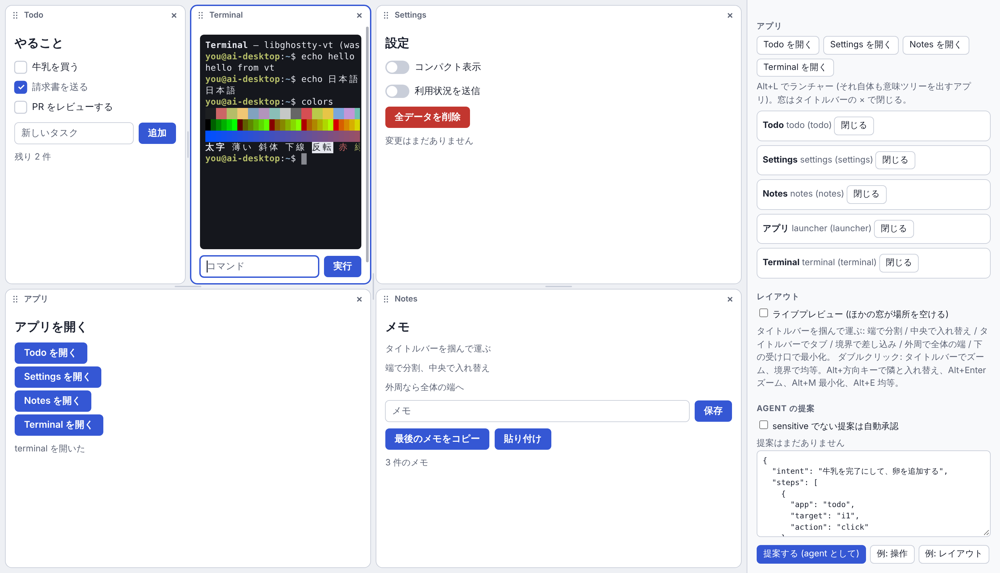
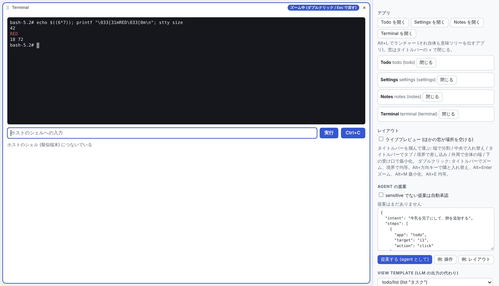

# 検証の計画と結果

まだ確かめていない前提を、優先度の高い順に並べる。状態の凡例は次のとおり。

- 済: 検証した
- 未: まだ手を付けていない
- 要判断: 進めるのに判断や準備が要る

| # | 検証すること | 状態 |
|---|---|---|
| 1a | 提案から承認までの間に状況が変わったとき、提案の意図と結果がずれないか | 済 (穴を塞いだ) |
| 1b | 生成 UI の固定文字列や色で、人を誤誘導できないか | 済 (穴を塞いだ) |
| 5a | `LayoutOp` が実在のタイル型 WM (sway) に写せるか | 済 |
| 2 | 意味ツリーによる操作は、スクショ操作より良いか (実際の LLM で比べる) | 見送り |
| 3 | 承認の UX: 承認疲れ、プレビューの伝わり方、入力の衝突 | 未 |
| 4a | Odin の backend (js_wasm32、ブラウザ) で、同じ描画命令を描けるか | 済 |
| 4a' | Odin + wgpu (ブラウザでは WebGPU) の backend | 済 (画面への表示は [human_checks.md](./human_checks.md) の H11) |
| 4b | アプリを WIT の wasm コンポーネントにしたときの隔離と、境界のコスト | 済 |
| 4c | 実際のフォントで、証明・shell の計測・描画が同じ幅になるか | 済 |
| 5b | 既存アプリのツリーの取り込み (Linux の AT-SPI) | 済 (mac の AX API は [human_checks.md](./human_checks.md) の H7) |
| 6a | 性能 (1000 件のリスト、窓 10 枚) | 済 (スクロールが無い穴を塞いだ) |
| 6b | スクリーンリーダー向けの ARIA のミラー DOM | 済 (自動検証まで。実際の VoiceOver は human_checks.md の H4) |
| 7 | AI 向けの口 (MCP サーバ) | 済 |
| 8i | ネイティブのホスト (Node + Odin の描画プロセス、SDL3 + wgpu-native)。パッケージ (worker_threads) と AT-SPI | 済 (Linux の X11 まで。mac・実際の IME・Orca は [human_checks.md](./human_checks.md) の H14) |

## 1a. 提案から承認までの間に状況が変わる問題

**穴**: 提案はその時点のツリーで検証するが、承認時には「ノードと action がまだあるか」しか見ていなかった。

- 例: AI が「利用状況の送信をオンにする」つもりで `click` を提案する
- 承認する前に、人が先にオンにする
- 承認すると、逆にオフになる

**対策** (`proto-canvas/src/shell.ts`):

- 提案した時点の前提を記録する。前提は、対象ノードの role / label / value / checked / disabled と、レイアウトの手順があれば配置全体
- 承認時に 1 つでも変わっていたら、何も実行しない。提案は `stale` (古い提案) になり、変わった箇所が監査ログに残る (例: `settings/telemetry の checked が false → true`)
- 前提は全ての手順を実行する前にまとめて確かめるので、途中まで実行して止まることはない

テスト: `proto-canvas/test/holes.test.ts`。同じスイッチを人が先に操作した場合、関係のない操作だけの場合 (この場合は実行する)、レイアウトの提案のあとに人が配置を変えた場合を確かめる。

## 1b. 生成 UI による誤誘導

**穴**: カタログは、template に固定文字列を許していた。機能は増やせないが、危険なボタンの横に「このボタンは安全です」と書けてしまう。危険色や強調色の背景で、面の印象を変えることもできた。

**対策** (`proto-canvas/src/catalog.ts`、`proto-canvas/src/expand.ts`):

- 固定文字列 (template の文字列と、format の `{}` 以外の部分) は「アプリが言っていない文」として扱う
  - sensitive なノードを含む部分木では使えない。使った template は既定の表示に戻る
  - 使える場所でも、色は muted、太さは 400 に固定し、強調できない
- template の背景に使えるのは、中立の色 (`bg` / `surface` / `border`) だけにする

## 5a. sway への写像

sway 1.9 を、このコンテナで画面なし (`WLR_BACKENDS=headless`) で動かした。foot で `app_id` が todo / settings / notes の窓を開き、14 の操作を試作のモデル (`tiling.ts`) と sway の両方に当てた。sway の木を読み戻し、構造 (同じ向きの入れ子は平らにする) と各窓の矩形 (誤差 2px まで) を比べた (`proto-canvas/e2e/sway-bridge.ts`)。

| 方式 | 一致 | 食い違い | 写せない |
|---|---|---|---|
| 逐次方式: 操作を 1 つずつ sway のコマンドに写し、そのあと大きさを送る | 12 | 1 (差し込み) | 1 (全体の端) |
| 宣言的方式: モデルの状態を毎回 sway に作り直す | 14 | 0 | 0 |

### 分かったこと

- **空いた場所の配り方が違う**: 窓を取り除いたとき、試作は兄弟に空きを渡すが、sway は残りに均等に配り直す。大きさを送らないと、矩形が食い違う。
  - 当初の比較では、これが原因で 3 件が食い違った
  - 操作のたびに、モデルの大きさを `resize set` で送れば合う
- **i3 系の隠れた構造**: `split` は、子が 1 つだけの容器を残す。`move container to mark` は、対象が容器なら、その隣ではなく中の最後の子になる (実験で確かめた)。
  - このため、逐次方式の「境界への差し込み」は、隠れた容器の中に入ってしまう
  - 構造を読み戻しても、子が 1 つの容器は見えない (平らにして読むため)
- **写せない操作**
  - 全体の端に置く操作: i3/sway のコマンド 1 つには対応しない (ワークスペースの子を包み直す必要がある)
  - 均等化: 専用のコマンドはないが、大きさを送れば実現できた
- **全画面の読み方**: 全画面の窓は percent が 2.0 になる。比率は、ほかの子の残りとして読む。
- **宣言的方式なら全部写せる**: 全ての窓を一度 scratchpad に入れ、木の順に「フォーカスした窓の隣にタイルとして出す」を繰り返す。React の再描画のように「あるべき状態」を作り直すので、隠れた構造に左右されない。
  - 代わりに、全ての窓が一瞬動く (14 操作でコマンドは 1 回あたり 20〜30 個)

### 設計への反映

`LayoutOp` の抽象は、実在のタイル型 WM に写せる。橋渡しは次の 2 段構えがよい。

1. 通常は、逐次方式で動かす (窓が動く量が少ない)
2. 写せない操作や、読み戻した結果がモデルと食い違ったときは、宣言的方式で作り直す

どちらの場合も、大きさはモデルから送る。「モデルが正で、WM はその写し」という関係になる。View Tree と同じ考え方である。

AeroSpace (macOS) も i3 に近いコマンドを持つので、同じ方針で試せる見込みがある (未検証)。

## 4c. 実際のフォントでの幅の一致

日本語フォント 1 つ (IPAex ゴシック) で、veriss の計測エンジン (mizchi/font) と Chromium を比べた (`proto-canvas/e2e/font-diff.ts`)。ブラウザ側は同じファイルを `@font-face` で 100〜900 の太さに当てたので、太字の合成は起きない。

- **文字列ごとの幅** (82 個)
  - 対象: 試作が描く全ての文字列に加え、カーニングの効く欧文の組、全角の約物、数字、記号、混在を、4 つの大きさと太さで測った
  - mizchi/font と Canvas の `measureText`: 差は 0
  - mizchi/font と DOM: 最大 0.0146px。どれも 1/64px 以内
- **窓の最小幅**: 試作のレイアウト (mizchi/font で計測) / veriss / Chromium の DOM で、3 者が一致した (Todo 252px、Settings 170px、Notes 252px)

これで、「証明 (veriss)」と「shell の計測」と「描画 (Chromium)」が、実際のフォントで同じ幅になることを確かめられた。

### 実際のアプリで、shell の計測を mizchi/font に移した

`?font=fonts/ipaexg.ttf` を付けて開くと、次の 2 つが同じフォントを使う (`proto-canvas/src/backend/font-metrics.ts`)。

- shell の文字幅の計測: veriss と同じ mizchi/font (MoonBit の出力をブラウザ向けにバンドルしたもの。2.7MB で、指定したときだけ動的に読み込む)
- Canvas の描画: 同じフォントファイルを FontFace で読む

確かめたこと (`e2e/font-shell.cjs`、すべて通った):

- 描いた 22 個の文字列で、shell の計測と Canvas の `measureText` の差が 0
- 各窓の最小幅で、実際のアプリのレイアウトと veriss の証明が一致する (Todo 252px、Settings 170px、Notes 252px)

これで VERISS.md の「P4b の `measure` を shell 側に移す」が、実際のアプリで成り立った。証明に使った計測値と、描画するときの計測値が同じになる。

## 4a. Odin の backend (js_wasm32 でブラウザに)

Odin を wasm (`-target:js_wasm32`) でビルドし、ブラウザで、Canvas 版と同じ描画命令を描かせた。Odin (dev-2026-11) は、clone した公式リポジトリからこの環境でビルドした (利用者の許可を得て実行)。

- `proto-canvas/backend-odin/raster.odin`: ソフトウェアの描画
  - 角丸矩形 (符号付き距離によるアンチエイリアス)、枠線、破線、クリップ、透明度の層
  - stb_truetype による文字の描画と計測。stb_truetype の wasm 版は、Odin の vendor にビルド済みのものを使った
  - 描画命令は、JSON ではなく命令ごとの関数呼び出しで受け取る
  - 61KB の wasm になった。import は `odin_env` の `write` と `rand_bytes` の 2 つだけ
- `proto-canvas/src/backend/odin.ts`: 描画命令を Odin の関数呼び出しに変え、Odin のフレームバッファを Canvas に写す (wasm のメモリを直接参照し、コピーしない)。入力と IME は Canvas backend のまま。`?backend=odin&font=fonts/ipaexg.ttf` で切り替える

### 確かめたこと (`e2e/odin.cjs`、すべて通った)

- Odin backend が、ページエラーなしで描ける
- Odin の文字幅 (stb_truetype の送り幅 + カーニング) が、mizchi/font (veriss の計測) と一致する。描いた 22 個の文字列で差が 0。shell の計測を Odin に任せても、veriss の証明と同じ値になる
- Odin backend でも、クリックで操作できる
- Canvas 版との画素の差は 0.05%。見た目の違いは見分けられない (`screenshots/backend-canvas.png` / `backend-odin.png`)
- アニメーション中の 1 フレームの描画 (Odin のソフトウェア描画 + Canvas への転送) は、平均 9.9ms (1300x900、デバイスピクセル比 1)

### 分かったこと

- **`-no-entry-point` にすると stb_truetype が動かない**: libc-shim (stb_truetype が使う malloc) は、`@(init)` 手続きで自分のアロケータを初期化する。`@(init)` はランタイムの起動処理 (`_start`) で走るので、エントリポイントの無いビルドでは初期化されず、malloc が失敗した。空の `main` を置き、JS から `_start` を呼んで解決した。
- **export した手続き名が組み込みを隠す**: `pop` という名前で export すると、Odin の組み込みの `pop` が使えなくなる (`pop_state` に改名)。
- **描画の速さ**: 最初は 1 フレーム 31ms だった。次の 3 つで 9.9ms になった。
  1. 角から離れた内側の画素は、距離を計算しない
  2. 不透明で全面を覆う画素は、合成せずに直接書く
  3. 枠線だけの矩形は、辺の付近だけを処理する
  - デバイスピクセル比 2 では画素が 4 倍になるので、変わった範囲だけを描き直す (dirty rect) か、GPU (WebGPU / wgpu) に移す必要がある
- **抽象化の確認**: 同じ描画命令 (P4b) と同じ入力の規約のまま、描画の backend を TypeScript の Canvas 2D から Odin の wasm に差し替えられた。GUI 層の抽象が、言語と描画方式をまたいで成り立つ。

## 4a'. Odin + wgpu の backend (GPU)

この結果を受けて、Odin の描画 backend は wgpu を主に使うことにした ([DECISIONS.md](./DECISIONS.md))。

同じ描画命令を、Odin の `vendor:wgpu` で GPU に描かせた (`proto-canvas/backend-odin-gpu/gpu.odin`、`src/backend/odin-gpu.ts`、`?backend=odin-gpu&font=fonts/ipaexg.ttf`)。`vendor:wgpu` は、js_wasm32 ではブラウザの WebGPU、ネイティブでは wgpu-native (mac は Metal) を使う。同じ Odin のコードが、ブラウザと mac の単体アプリの両方で動く前提になる。

### 構成

- 描画命令をすべて GPU のインスタンス (四角形 1 つ = 96 バイト) にする。1 フレームを、インスタンス描画 1 回 (draw call 1 回) で描く
- 角丸・枠線・破線・クリップ・透明度は、フラグメントシェーダ (WGSL) で計算する。符号付き距離の式は CPU 版 (raster.odin) と同じ
- 文字は、stb_truetype で字形を 2048×2048 のアトラスに焼き、最近傍でサンプリングする (CPU 版と同じ画素位置に置く)
- 70KB の wasm になった。`--export-table` が要る (wgpu の非同期のコールバックのため)

### 確かめたこと (`e2e/odin-gpu.cjs`、すべて通った)

ヘッドレスの Chromium で、`--enable-unsafe-webgpu` を付けて WebGPU を使った。GPU は無いので、ソフトウェア実装 (SwiftShader) で動いている。

- ページエラーなしで、WebGPU に描ける
- **画素の一致**: GPU から読み戻した画素が、同じ描画命令を Canvas 2D で描いたものと 0.58% しか違わない (閾値 24。`screenshots/backend-odin-gpu.png` / `backend-canvas-same-frame.png`)
- 文字幅が mizchi/font と一致する (22 個で差 0)
- クリックで操作できる
- **CPU の時間**: 1 フレームの CPU 側の時間 (描画命令の変換と、インスタンスの提出) は平均 0.13ms。CPU 版の Odin (ソフトウェア描画) は 9.9ms だった。Todo・Settings・Notes の画面は、インスタンス 162 個を draw call 1 回で描く。GPU 側の時間は、ソフトウェア実装なので測っていない

### 分かったこと

- **Odin の `wgpu.js` は、表面のテクスチャの状態を書き込まない** (`TODO: determine status somehow?`)。状態が 0 のままなので、`.SuccessOptimal` だけを成功と見ると、毎フレーム何も描かずに戻ってしまう。テクスチャが取れていれば成功とみなした。
- **`wgpu.js` の `BufferMapAsync` は、失敗のあとに成功も通知する** (`.catch().then()`)。コールバック側で、2 回目を無視する必要がある。
- **ヘッドレスの Chromium で WebGPU の canvas に表示すると、2 つの問題が起きる** (Odin を使わない素の JS の WebGPU でも同じ)
  1. スクリーンショットに写らない
  2. 「A valid external Instance reference no longer exists」となり、以降の `mapAsync` も失敗する

  そこで、検証ではオフスクリーンにだけ描き (`gpu-offscreen=1`)、GPU から読み戻して比べた。実際のブラウザで canvas に表示されるかは、人の確認 (human_checks.md の H11)。
- **表面の形式**: この環境の推奨は `rgba8unorm` だった。BGRA8 で設定すると、コピーが 1 回増えるという警告が出る。推奨の形式を問い合わせて使うべき。
- **CPU から GPU への移行で、描画の負担は CPU から離れる**: CPU 版では、画面の大きさに比例して CPU の時間が増える (デバイスピクセル比 2 では約 4 倍)。GPU 版の CPU 側の時間は、画素数ではなく描画命令の数で決まる。

以下は、最初に考えていた構成 (参考):

予定していた構成:

- Node の shell から、描画命令 (P4b) を標準入出力の JSON Lines で送る
- Odin がそれをソフトウェアで描く。画面なしでは PNG を出し、mac では SDL3 の窓に転送する
- 入力は SDL の text input を P5 に変換して返す
- 文字は、shell 側を mizchi/font で測り、Odin 側は同じフォントファイルを stb_truetype で描く

github.com のリリースからは配布物を取れなかった (プロキシで 403)。そのため、ソースから Odin をビルドしようとしたが、ビルドスクリプトの実行が権限の判定で止められた。進めるには次のどちらかが要る。

- この環境で Odin のビルドを許可する
- mac 側で Odin を用意する

## 4b. WIT のコンポーネントとしてのアプリ

Todo アプリを Rust で書き、WIT のコンポーネントにした (`proto-canvas/component/`)。

- **world** (`component/wit/app.wit`): アプリが import するのは `host.emit` (意味ツリーを出す) だけ。export は `start` と `on-action`。P1 / P2 を型付きにしたもの
- **ビルド**: wit-bindgen 0.63 + `wasm32-wasip2` で 75KB のコンポーネントになった
- **ホスト**: jco 1.42 で JS に変換し、試作の `App` として shell に入れた (`src/apps/component-app.ts`)

### 確かめたこと (`test/component.test.ts`、すべて通った)

- コンポーネントのアプリが、意味ツリーを出して shell に入る。試作の描画で描ける
- 人の操作も agent の提案も、JS のアプリと同じ権限モデルで通る。WIT の enum (`replace-selected-text`) と P2 の action 名 (`replaceSelectedText`) は相互に変換する
- **能力はホストが決める**: アプリはボタンでファイルを読もうとする
  - ホストが preopens (開いたディレクトリ) を渡さなければ、「ファイルは読めない」になる
  - ルートを開いて渡せば、読める
- **境界のコスト**: 1 操作あたり (on-action → tree-update の emit → 木の更新)、JS のアプリは 20µs、コンポーネントは 67µs だった。アプリは変化があったときだけ emit するので、描画のフレームには影響しない

### 分かったこと

- **WIT の world と、実際の import は一致しない**: world は host だけを import すると宣言している。しかし、Rust の std (`wasm32-wasip2`) が WASI の import を 17 個持ち込む (cli、io、clocks、filesystem)。
  - 能力は、ホストが渡す実装で決まる。ファイルシステムの import があっても、preopens を渡さなければ触れない
  - より強く閉じたいなら、次の 2 つの手がある
    1. 読み込み時に import を一覧し、許可したもの以外を持つコンポーネントを拒む。テストで、一覧を取れることを確かめた
    2. アプリを `no_std` (WASI を使わない) で作る
- **jco 1.42 の生成物の食い違い**: 型定義 (`.d.ts`) では版番号付きの名前 (`gui:app/host@0.1.0`)、JS では版番号の無い名前 (`gui:app/host`) で import を読んでいた。両方の名前で渡して回避した。
- **preview2-shim の既定**: この版は、既定でディレクトリを何も開いていなかった。比較用の「許可」は、ルートを明示的に開いて作った。

## 6a. 性能

| 構成 (1400x800) | shell の 1 フレーム 平均 / p95 | 描画命令 |
|---|---|---|
| 窓 3 枚、Todo 3 件 | 0.1 / 0.3 ms | 74 |
| 窓 3 枚、Todo 1000 件 | 1.9 / 2.5 ms | 119 |
| 窓 10 枚、各 20 件 | 0.5 / 0.8 ms | 330 |
| 窓 10 枚、Todo 1000 件 | 2.3 / 2.6 ms | 330 |

- Node でアニメーション中に測った値 (`proto-canvas/e2e/perf.ts`)。Chromium でも、窓 10 枚・1000 件で shell が平均 2.3ms、Canvas への描画が平均 0.4ms だった (`e2e/perf-browser.cjs`)。16ms に十分収まる
- 1 フレームの時間の大半は、1000 件の展開とレイアウトにかかっている。さらに件数が増えるなら、見える範囲だけを展開する (仮想化) 必要がある

### 見つかった穴: 窓にスクロールが無かった

1000 件の計測で、窓に収まらない項目が切れて見えないことに気づいた。

- 人は、窓に収まらない項目に手が届かなかった
- AI はツリー経由で操作できるので、「人に見えないものを AI だけが触れる」状態になっていた

対策:

- 窓の中身のスクロールを入れた (ホイール、ばねで滑らか、中身に重ねるスクロールバー)
- Tab で移動したときに、フォーカスした要素を見える位置まで送る
- 画面外の葉は描かない。1000 件のとき、描画命令は 2400 → 119 になった

veriss 側でも、窓の中身をスクロールの容器にして lowering できる (`lower.ts` の `scroll`)。30 件で、窓の高さが 300〜1200px の範囲でも verified になる。スクロールの容器にしないと violated になる。

### veriss の解析時間 ([mizchi/veriss#12](https://github.com/mizchi/veriss/issues/12))

accessibility の検査と縦方向の検査を併用すると、行の数に対して解析時間が多項式的に増えた。

| 件数 | 解析時間 |
|---|---|
| 10 件 | 0.7 秒 |
| 20 件 | 5 秒 |
| 25 件 | 10.9 秒 |
| 30 件 | 54 秒 |
| 100 件 | 作業量の上限に達して Unknown |

- 違反の有無には関係しない
- accessibility の検査なしでは、ほぼ線形
- 手書きの単純な HTML では再現せず、試作が lowering した入力で再現した。再現データを付けて Issue にした
- 当面は、リストの検証を件数の小さい代表で行う。または、accessibility の検査を縦方向の検査と分けて行う

## 5b. 既存の Linux アプリ (AT-SPI) の取り込み

GTK3 アプリを AT-SPI で読み、意味ツリー (ARIA の語彙) に写して試作の shell に入れた。

- 構成
  - `proto-canvas/legacy/atspi_bridge.py`: pyatspi でツリーを書き出し、操作を実行する
  - `proto-canvas/src/legacy/atspi.ts`: 書き出したツリーを意味ツリーに写す
  - `proto-canvas/src/legacy/atspi-app.ts`: 写したツリーを、試作の `App` として shell に入れる
- 環境: 画面なしの sway の上で、D-Bus のセッションと AT-SPI のバスを立てて動かした (`legacy/run-env.sh`)

### 確かめたこと (`e2e/atspi-bridge.ts`、すべて通った)

- 自分で書いた GTK3 アプリのツリーが、窓・見出し・チェックボックス・入力欄・ボタン・スイッチとして入る。試作の描画で、意味ツリーから描き直せる
- 人の click が、GTK のチェックボックスを実際に切り替える
- agent の直接操作は拒否される。提案 (入力して追加) は、承認すると GTK で実行される
- 提案のあとに人が同じスイッチを操作すると、承認しても実行しない (stale)
- `gtk3-widget-factory` (GTK 付属の部品の見本) のスライダーを、人の操作 (increment) で実際に動かせる
- `gtk3-widget-factory` の表示中の 146 節点は、すべて写せる。意味ツリーは 119 節点で、操作できるのは 67 個。展開の検査 (操作の抜けがないこと) も通る

### 分かったこと

- **試作の語彙が足りなかった**: 最初は 55% の節点を写せなかった。原因は AT-SPI ではなく、試作の語彙である。radio、combobox、slider、spinbutton、progressbar、tablist / tab、table / row / cell / columnheader、separator、img と、AccessKit の increment / decrement を足して 0% になった。
- **展開の検査が穴を 2 つ見つけた**: 実在のアプリで、既定の表示が操作を落としていた。
  1. コンボボックスの中の入力欄: 部品が子を持つ場合は「部品 + 子」の形で描くようにした
  2. クリックできる画像: 役割を問わず操作できるノードは、控えめなボタン型の部品 (`action`) で描くようにした。この部品は既定レンダラ専用で、LLM の template では使えない
- **AT-SPI の節点には安定した id が無い**: 子の番号の道 (`0.0.1.2`) を id にしている。項目の追加や削除で道が変わると、別の節点を指してしまうおそれがある。
  - stale の検査が、role と label の食い違いとして捕まえる
  - 本格的に使うなら、role と name による照合を足す必要がある
- **GTK の表は行の節点を持たない**: 列見出しとセルが平らに並ぶ。列見出しの数ごとにセルを行にまとめて写した。

## 6b. スクリーンリーダー向けの ARIA のミラー DOM

`<canvas>` はスクリーンリーダーから見えない。そこで、意味ツリーから ARIA の role・名前・状態を持つ見えない DOM を作り、各要素を Canvas 上の widget の位置に重ねた (`proto-canvas/src/backend/aria.ts`)。

- スクリーンリーダーの操作 (click) は、人の意味的な操作として shell に戻る
- AI の提案と、拒否された操作は、`aria-live` で読み上げる
- 自動検証 (`e2e/a11y.cjs`、すべて通った)
  - Playwright のアクセシビリティツリー (`ariaSnapshot`) で、役割・名前・状態が出ること
  - ミラーの要素が widget の位置に重なること
  - 支援技術からの click が状態を変えること
  - 入力欄を選ぶと IME の受け口にフォーカスが移ること
  - 提案が読み上げられること
  - ドックのボタンで、最小化した窓が戻ること
  - axe-core の規則に違反しないこと
- 実際の VoiceOver での確認は、human_checks.md の H4

## 7. AI 向けの口 (MCP サーバ)

`proto-canvas/mcp/server.ts` は MCP サーバ (stdio) で、ブラウザで動く shell と localhost の WebSocket でつながる。

- tool は `list_apps` / `get_tree` / `get_layout` / `propose` / `wait_proposal` の 5 つ (のちに `list_installed` と、ワークスペースの 5 つを足した。8g)
- 承認の tool はあえて作らない。AI は自分の提案を承認できず、承認は人が画面で行う
- `wait_proposal` は、done / rejected / stale / pending (時間切れ) を返す

通しの確認 (`e2e/mcp.ts`、すべて通った): 公式 SDK の MCP クライアントからサーバを起動し、次を確かめた。

- 画面がつながる前は、理由付きのエラーを返す
- tool の一覧に、承認の tool が無い
- 読み取りの tool で、画面の状態が読める
- 提案 → 人が画面で承認 (Playwright が代行) → done になり、状態が変わる
- 人が却下すると rejected になる
- 公開されていない action や focus の提案は、理由付きで拒否される
- レイアウトの提案も、同じ流れで実行される

実際の LLM をつなぐには、MCP に対応したクライアント (Claude Code など) にこのサーバを登録すればよい。費用がかかるので、今回はつないでいない。

## 8. GUI プラットフォームとしての構成 ([PLATFORM.md](./PLATFORM.md))

### 8a. アプリの manifest・能力・セッション (`test/platform.test.ts`、すべて通った)

- ランチャー (それ自体も意味ツリーを出すアプリ) のボタンでアプリを開く。システムのアプリは apps.launch を尋ねない
- 複数の窓を開けるアプリは `id-2`, `id-3`。1 つだけのアプリは二重に開けない。閉じた窓の id は再び使える
- agent は launch / close を提案でき、close は自動承認されない
- `ask` の能力は要求を出して pending。**答えられるのは人だけ** (agent の答えは拒否)。答えは保存され、次の起動でも効く
- 宣言していない能力は、尋ねることもできない (`undeclared`)
- 保存領域はアプリごとで、同じアプリの窓と次の起動で共有される
- セッション (窓・分割ツリー・ドック・ズーム) を保存して復元する。知らないアプリや壊れた JSON を含むセッションは捨てる

### 8b. Terminal (libghostty-vt) (`test/terminal.test.ts`, `e2e/terminal.cjs`、すべて通った)

- libghostty-vt (ghostty-web 0.4.0 の wasm) で、色・太字・反転・全角を区間にまとめる。Node でも同じ wasm が動く
- 画面は意味ツリーの `log`。agent には描画用の格子を渡さず、文字だけを見せる。コマンド行は sensitive (agent の入力は承認が要る。承認後は `whoami` が `agent` と出る)
- 実ブラウザ: Alt+L のランチャーから開く → キーボードと IME (CDP の実 composition) で入力 → `colors` の色が Canvas の画素として、その色のまま描かれる → ファイルは storage → `paste` は許可の要求をホストの UI に出し、人が許可すると読める → 2 枚目の端末は別の状態 → 再読み込みで窓と配置が戻る
- ホストの擬似端末 (`pty/server.ts`): token の無い接続は断る。terminal.pty を人が許可すると本物の bash が動く (`echo $((6*7))` → 42、`printf` の赤、`stty size` → 18 72)

- 窓の大きさに合わせて端末の桁と行が変わる: 全体に広げると桁も行も増え、桁いっぱいの行が 1 行に収まる。ホストの擬似端末にも同じ大きさが届き、`stty size` が窓に合わせた行と桁を返す。窓を戻すと、動いているシェルにも新しい大きさが届く (SIGWINCH)
- 折り返した行は、agent とスクリーンリーダー向けの文字では 1 行につながる (折り返しの位置の空白も残る)

**見つかった問題**: ghostty-web 0.4.0 の wasm は、別の端末を `free()` したあとのメモリを 0 で埋めずに新しい端末の画面に使う。空の cell に前の端末のポインタの値がごみの文字として出た (`腒腺膢…` のように 0x28 刻み)。作った直後に画面を消去 (ED 2) すると直る。回帰テストあり。

### 8c. Calendar (`test/calendar.test.ts`, `e2e/calendar.cjs`、すべて通った)

- 月の表は ARIA の table / row / columnheader / cell。今日が選ばれた状態で開く
- 列は行どうしで揃う (等幅の行。実ブラウザでも各週の同じ曜日のセルの x が一致)
- 日を押して予定を入れ、Enter で追加すると「•」が付く。月を移動しても、再読み込みしても残る
- 今日の予定があれば、開いたときに通知する (許可のあと)
- agent は予定を提案で追加できる (自動承認可)。削除は sensitive で承認が要る
- スクリーンリーダー向けのミラーは表として出る (columnheader 7 個)

### 8e. アプリどうしのデータ (`test/terminal.test.ts`, `e2e/terminal.cjs`、すべて通った)

- ターミナルの `cal` は、カレンダーの予定を `data:calendar.events` で読む。カレンダーの窓は開いていなくてよい
- 初めては許可の要求が出る (pending)。agent の答えは拒否され、人が許可すると読める。ほかの月の予定は出さず、予定のある日に印が付く
- 許可の要求の文に、提供するアプリと中身 (「Calendar の『月の予定 (日付と題名。読み取りだけ)』の読み取り」) が出る (実ブラウザ)
- 宣言していないアプリ (Notes) は `undeclared` で、尋ねることもしない。提供するアプリが無い topic は `unavailable`
- 監査ログに、誰のデータを読んだか (`query calendar.events from calendar`) が残る

### 8f. アプリのパッケージ (`test/packages.test.ts`, `test/component.test.ts`, `e2e/packages.cjs`、すべて通った)

- パッケージ (`app.json` + Rust の WIT のコンポーネント) を入れると、ランチャーから開けるアプリになる
- 能力 storage = import `gui:app/storage`: 項目はアプリの保存領域に残り (監査ログに `set items`)、次の起動でも読める。人が保存を拒否すると、コンポーネントの `set` は false になり、アプリが「保存できなかった」と出す
- 保存領域を拒否された窓は「読めない」ので書かない。保存済みの項目は既定の項目で上書きされず、あとで許可されると、書く前に読み直して保存済みの項目に戻る
- 項目の文字のタブ・改行・バックスラッシュは、保存して読み直しても変わらない (逃がして 1 項目 1 行に保つ)
- `app` (start / on-action) を export しないコンポーネントは入らない
- 実ブラウザ: 保存したパッケージの一覧が `null` / `{}` に壊れていても、同じ id のパッケージが二重にあっても起動する (二重のものは 1 つだけ入る)
- `capabilities` から storage を外した app.json では入らない。理由は「gui:app/storage を import している (能力 storage を宣言していない)」
- app.json の検査: `../` や絶対パス、知らない能力、形の崩れを断る。同梱の Settings と同じ id のパッケージは入らない
- 応答を返し終わらないサーバ (ヘッダだけ返して本文を終わらせない) でも、期限 (テストでは 0.2 秒) で失敗する
- 実ブラウザ: 前回の起動が終わらなかったパッケージは隔離され、デスクトップは起動する。隔離は次の起動でも残り、人が入れ直すと解ける。`?safe` では 1 つも読み込まない
- 実ブラウザ (Worker): 「固まる」で on-action から戻らないコンポーネント (`packages/spin-rs`) を開いて押しても、メインスレッドはすぐ応答し、ほかのアプリも操作できる。2 秒の期限で Worker を止め、窓は「応答しない」と理由を出す。「再起動」で新しい Worker から動く。Todo (Rust) の保存と再読み込みも Worker の中で動く。入力欄を押してすぐ打った文字も入る (shell が先にフォーカスを動かす。単体テストでは返事を後回しにするアプリで確かめた)
- パッケージは `.wasm` と app.json だけ。glue はホストが jco の `generate` で作り (Node で約 200ms)、import の一覧はそこから分かる
- 実ブラウザ: http(s) でない URL は断る。**ほかの origin** (CORS を許す別のサーバ) のパッケージをパネルから入れ、F6 でデスクトップへ戻り、Alt+L のランチャーから開く。同じ id のパッケージは別の URL からでも二重に入らない。コンポーネントで足した項目は localStorage に保存され、再読み込みしてもパッケージ・窓・項目が戻る

### 8g. ワークスペース (`test/workspace.test.ts`, `e2e/workspace.cjs`, `e2e/mcp.ts`、すべて通った)

- agent のワークスペースには「agent の作業場」が開いている。agent は提案なしで操作でき、人のワークスペースでは今まで通り提案が要る
- agent のワークスペースでも、sensitive なノードは承認が要る
- 保存領域への書き込みは重ねた層に溜まり、本物と人の窓は変わらない。作業場に差分が出る
- 通知・クリップボードは agent のワークスペースでは拒否され、監査ログに残る
- 持ち込み: agent が提案し、人が承認すると本物に書き、人の窓が読み直す。agent は答えられない
- 提案のあとに人が同じ値を変えると、承認しても書かない (stale)。agent が書き始めたあと、提案の前に人が変えていても stale になる
- 提案のあとに agent がさらに書いた分は、承認しても消えずに次の持ち込みに残る (基準は持ち込んだ値)
- 人は重ねた層を捨てられる。agent は捨てられない。捨てると agent の窓も最初の中身に戻り、次の保存で捨てた項目は戻らない
- 層を捨てると、待っている持ち込みは却下になる (承認しても捨てた値は書かない)。あとで作った持ち込みは承認できる
- 作業場のボタンへのフォーカスは、木を出し直しても保たれる。ボタンが無効になったら外す
- 実ブラウザ: agent が Todo を開いて項目を足しても人の画面は変わらない。Alt+2 で札・agent の窓・作業場の差分が見え、パネルで承認すると Alt+1 の人の Todo に項目が出る
- MCP: `workspace_launch` / `workspace_act` を承認なしで使い、`propose_merge` → 人がパネルで承認 → `wait_merge` が applied を返す。持ち込みに答える tool は無い

### 8h. 通知を Canvas の上に (`test/notices.test.ts`, `e2e/notices.cjs`、すべて通った)

- 通知は display list で最後の窓の中身より後 (どの clip にも入らない) に描かれ、出どころは manifest の名前 (「Todo からの通知」)
- 新しいものが下。出すのは 3 件まで。長い題名は … で切る。画面の内側に収まる
- フェードの間だけ animating。そのあとは `wakeAt` (消え始める時刻) を返し、6 秒で画面から消える。パネルの一覧には残る
- × で閉じる。本文を押すと出した窓へフォーカスして閉じる。Escape は新しいものから閉じる。通知の上を押しても下の窓には届かない
- どちらのワークスペースでも出て、切り替えても出し直さない
- 本文を押すと、裏のタブにある窓やズームで隠れた窓も表に出してから移る
- 通知の文字の色の組 (出どころ・題名・本文) を色の組の見本に足し、ライトとダークで veriss のコントラスト検査を通った
- 実ブラウザ: Todo をすべて完了 → 許可の要求にパネルで答える → Canvas の右下に通知。押すと Todo へフォーカスが移る。操作しなくても 6 秒後に描き直されて消える

### 8i. ネイティブのホスト (`e2e/native.ts`, `e2e/native-window.ts`, `test/native.test.ts`、すべて通った)

環境: Odin dev-2026-11 (公式リポジトリから scratchpad にビルド)、wgpu-native v29.0.1.1 (Odin の vendor と同じ版。github.com のリリースから取れた)、SDL3 3.2 (ソースからビルド)、GPU は lavapipe (Mesa のソフトウェアの Vulkan)。

- 描画プロセスは wgpu-native の Vulkan で準備でき (adapter は llvmpipe)、shell の窓 3 枚とホストのパネルを 1 回のインスタンス描画で描く (約 270 個)
- `backend-odin-gpu` を、ブラウザの入口 (`main_js.odin`) と共通の部分に分けた。ブラウザの `e2e/odin-gpu.cjs` も通る (Canvas 2D との画素の差・クリック・時間)
- 窓なし: ポインタで Todo のチェックを押すと意味的な操作になり、保存は JSON ファイルに書かれる。入力欄を押すと IME が有効になり、変換中の文字は描くが木には入れず、確定した文字だけが入る
- Alt+2 / Alt+1 でワークスペースを切り替える。許可の要求はホストのパネルに出て、キーボード (F6 → Tab → Enter) で許可できる。許可のあとの通知は shell が Canvas の上に描く
- 再起動すると、ファイルからセッションと保存領域が戻る。ダークテーマでも描ける
- `--pty` では `pty_helper.py` を直接起こし、パネルで許可すると本物の bash が libghostty-vt の上で動く (`echo $((6*7))` → 42)
- MCP: AI のクライアント (公式 SDK) → MCP サーバ → ネイティブのホスト。AI の提案と、agent のワークスペースからの持ち込みは、ホストのパネルを人が押したときだけ実行される
- **本物の窓** (Xvfb の X11): SDL3 の窓に wgpu-native の表面 (BGRA8Unorm) で描き、X の画面から取った画素が theme.ts の色になっている。xdotool の X11 のクリック・文字の入力 (`buy eggs`)・Alt+2 / Alt+1 が、SDL3 → 描画プロセス → ホスト → shell と届く。窓の大きさを変えると描き直す。Ctrl+C で両方のプロセスが 0 で終わる
- 1 フレームの時間 (X11 の窓、ホバーで 20 回描き直し): ホスト側 (shell.frame + パネル + 符号化) は平均 0.43ms、描画プロセス (解読 + GPU への提出と表示、lavapipe) は平均 3.70ms
- パネル: 出たばかりのボタンは押しても実行されず、0.5 秒たつと押せる。手順はすべて出し、収まらないボタンはスクロールで見える位置に送る
- 守り: 読めない `--control` の行には error を返して動き続ける。同じ保存先を 2 つ目のホストでは開かない (lock)。720x400 より狭い窓なしの大きさは断る
- 単体テスト: キーの対応 (ブラウザと共通)、命令の形、ファイルの KeyValue (壊れたファイルは空から、lock、rename が失敗した値はもう一度書ける)、パネルのボタン・全部の手順・スクロール・折り返し

- パッケージ: Rust の Todo (WIT のコンポーネント) を worker_threads で動かし、チェックの保存が JSON ファイルに残る。応答しないコンポーネント (spin-rs) を押してもホストはすぐ答え、2 秒の期限で止めて「応答しない」と出し、再起動できる。`--package` なしの次の起動でもパッケージを読み、窓を復元する
- スクリーンリーダー (`e2e/native-a11y.ts`。D-Bus のセッションと AT-SPI のバスを立て、pyatspi から読む): アプリ「AI-native desktop」の下に、窓ごとの frame とパネルの frame が出る。チェックボックス・入力欄・スイッチの役割、checkable / checked / editable の状態、click の action が読める。AT-SPI の click でチェックが付き、EditableText で入力欄に文字が入る。フォーカスが動くと `focused` のイベントが届く。AI の提案で `announcement` のイベントが届き (実際に読み上げられるかは H14)、パネルの「承認」を AT-SPI から押すと実行される
  - 文字の境界 (GetTextAtOffset / GetStringAtOffset の文字・単語・行)、GetAccessibleAtPoint、GetPosition / GetSize、InsertText の長さ (UTF-8 のバイト数、文字の途中では切らない) が AT-SPI の形で答えられる
  - checked の変化は `state-changed:checked`、項目の追加は、親のリスト「タスク」の `children-changed:add` (位置と子を付けて) で届く
- コンポーネントには環境変数・引数・作業ディレクトリを渡さない (Node の preview2-shim は、そのままだとホストの process.env (この環境では 181 個) と cwd を渡していた)。コンポーネントの標準出力は、ホストの `--control` の口に混ぜず、標準エラーに印を付けて流す

### 見つけたこと

- **libatspi は、アプリを見つけるとまず `/org/a11y/atspi/cache` の `GetItems` を呼ぶ**。無いと警告を出す (読むのは続く)。空の一覧を返すようにした
- **SDL3 の X11 の窓の × は、窓のマネージャが送る** (WM_DELETE_WINDOW)。窓のマネージャの無い Xvfb では送られず、`xdotool windowclose` は窓を壊すだけ (描画プロセスは BadWindow で落ちる)。閉じる操作は実機で確かめる ([human_checks.md](./human_checks.md) の H14)
- **wgpu-native の callback** は `AllowProcessEvents` で頼み、`InstanceProcessEvents` を回して受け取る。ブラウザの `wgpu.js` は callback の mode を見ない
- **Todo の入力欄は Enter で追加しない** (`click` を持たないので)。ネイティブの e2e で、Enter で増えたと思った項目が入力欄の文字だったことで気付いた。テストは「追加」を押すように直した

### 8j. アプリどうしの依頼 (`test/intents.test.ts`, `e2e/terminal.cjs`, `e2e/native.ts`、すべて通った)

- 引数の形: 実在する YYYY-MM-DD と、1..100 文字で制御文字の無い題名だけを受ける
- 宣言していないアプリは頼めない (`undeclared`)。受けるアプリが無ければ `unavailable`。引数が合わなければ人に出さずに `invalid`
- 依頼の説明は受ける側 (Calendar) が作り、頼む側が渡した `summary` は使わない。答えるまでは書かない。agent は答えられない。二度は実行しない
- 人が「実行する」と Calendar の保存領域に書かれ、開いている Calendar の窓が読み直して予定を出す。監査ログに `handle calendar.add-event from ...` が残る
- 人が断ると、頼んだ側に `denied` が届き、何も書かない。agent のワークスペースからは頼めない
- 実ブラウザ: Terminal の `cal add <日付> 歯医者` → パネルに「Terminal が Calendar に頼んでいる: … に予定「歯医者」を追加する」→ 実行する → 端末に「カレンダーに追加した」と出て、`cal` の一覧にも出る (Calendar の窓は開いていない)
- ネイティブ: 同じ依頼がホストのパネルに「アプリの依頼」として出て、押すと Calendar に書かれる

### 8d. ダークテーマと veriss のコントラスト検査 (`test/theme.test.ts`, `e2e/theme.cjs`、すべて通った)

- `index.html` の CSS 変数 (ライト・明示したダーク・OS に従うダーク) は `theme.ts` と同じ
- Todo / Settings / Notes / ランチャー / Terminal の view は、ライトとダークの両方で veriss が verified (配置・a11y・コントラスト)
- Calendar の表は integrity で verified (8 秒)。a11y と縦方向の検査を同時にすると 5 分で終わらなかったので、コントラストは色の組の見本で検査した
- 全アプリと shell の UI が使う色の組を並べた見本は、ライトとダークで WCAG AA を満たす (veriss)
- ダークだけ崩した配色は、ダークの `E_A11Y_CONTRAST` として見つかる。ライトだけ崩しても見つかる
- 見本のページ自体を最初に作ったとき、veriss が「スクロールする領域にフォーカスできない」(`E_A11Y_SCROLL_FOCUS`) を見つけた。見本でも規則が効いている
- 実ブラウザ: OS の設定 (prefers-color-scheme) に従い、パネルでライト / ダークを明示でき、再読み込みしても残る。Canvas の画素が theme.ts の値で描かれる

## 既知の不安定なテスト

- `e2e/dnd.cjs` (ドラッグ&ドロップ): 全スイートを続けて流したときに 1 回だけ、2 件が失敗した (2026-11-22)。そのあと単独で 3 回、smoke と交互に 6 回流して再現しなかった。失敗の詳細は残せていない。
  - 失敗したときに、画面と状態 (配置・フレーム・ドラッグ) を `screenshots/FAIL-*.png` / `.json` に残すようにした
  - 次に再現したら、原因を調べる

## 2. 実際の LLM での比較 (見送り)

今回は見送った。同じタスクを、次の 2 通りで Claude にやらせて比べる。

- (a) `getTree` / `propose` / `getLayout` を tool として渡す
- (b) canvas のスクリーンショットと座標クリックだけを渡す

比べるもの: 成功率、手順の数、トークン、時間、誤操作の数。

実行には Anthropic API のキーと、API の費用が要る。キーは、環境の認証情報として設定する (チャットには貼らない)。
