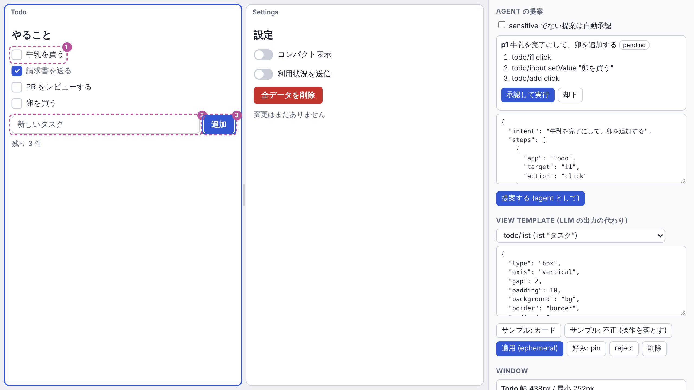
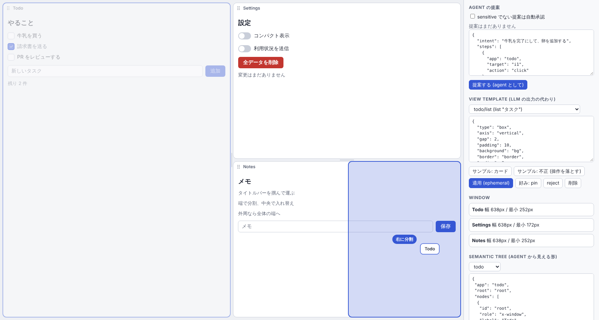

# proto-canvas

[PROTOCOL.md](../PROTOCOL.md) のパイプラインを、ブラウザの Canvas で最小限に通した試作。



## 何があるか

| 層 | ファイル | 内容 |
|---|---|---|
| P1 意味ツリー | `src/tree.ts`, `src/apps/*.ts` | Todo と Settings の 2 つのアプリ。view を知らず、ARIA 語彙のツリーを出すだけ |
| P2 意味的な入力 | `src/shell.ts` `dispatch` | 人間のクリックやキー入力は、hit test でノードを特定して action にする。agent は承認済みの提案の範囲でしか通らない。すべて監査ログに残る |
| P3 template | `src/catalog.ts` | json-render 風のカタログ。静的検査 (語彙・値の範囲・自己再帰の禁止) |
| キャッシュ | `src/signature.ts`, `src/cache.ts` | 構造シグネチャ (値と件数に依存しない) → template。ephemeral / pinned / rejected |
| 展開 | `src/expand.ts` | 決定的に展開する。操作できるノードの抜け・重複、role との不一致があれば、その template を捨てて既定レンダラに戻す |
| レイアウト | `src/layout.ts` | portable な flex の部分集合の簡易版 (後で crater-layout に置き換え、veriss で証明する) |
| P4b 描画 | `src/render.ts`, `src/backend/canvas.ts` | display list → Canvas 2D |
| P5 IME | `src/backend/canvas.ts` | 隠し textarea に OS の IME を任せる。preedit は表示だけで木に入れず、確定文字列を `replaceSelectedText` にする |
| veriss への lowering | `src/lower.ts` | View Tree → HTML + CSS + 文字の契約 ([VERISS.md](../VERISS.md)) |
| タイル | `src/tiling.ts`, `src/anim.ts`, `src/shell.ts` | 分割ツリー。窓のタイトルバーを掴んで運ぶと分割・入れ替えができる (下記)。境界はドラッグで動かせる。最小幅を下回ると「はみ出し」を出す |

右のパネルでは、次のことができる。

- agent として提案する (ゴースト表示 → 承認 / 却下)
- template を貼って適用・pin・reject する (LLM の出力の代わり)
- agent から見える意味ツリーと監査ログを見る

ブラウザのコンソールからは `agent.getTree()` と `agent.propose(intent, steps)` が使える。どちらも MCP の tool にそのまま写せる形にしてある。

## 窓のドラッグ&ドロップ



VS Code のエディタ分割と同じ要領で、タイトルバー (左の ⠿) を掴んで運ぶ。

| 落とす場所 | 結果 |
|---|---|
| 別のペーンの端 (各辺から 28% の帯) | そのペーンをその向きに 2 分割し、運んだ窓を入れる |
| 別のペーンの中央 | 2 つの窓を入れ替える |
| ワークスペースの外周 (28px の帯) | 全体をその向きに 2 分割し、端に置く |
| Escape | 取り消す |

- ドラッグ中は、ドロップ先が青い半透明の矩形と「右に分割」などのラベルでプレビューされる。プレビューは、ポインタの位置から広がって現れる。候補が変わると、少し弾むばねで次の候補へ滑る
- 離すと、すべてのタイルが臨界減衰のばねで新しい位置へ動く。中身は、各フレームでその時点の幅に合わせて配置し直す
- 分割すると、どれかの窓が自分の最小幅を下回る場合は、プレビューが赤くなる。理由 (「Notes が最小幅 252px を下回る」) が出て、離しても何も変わらない。最小幅は veriss で証明している下限と同じ値 ([VERISS.md](../VERISS.md))
- アニメーションは時刻を外から渡して進めるので、単体テストで決定的に確かめられる (`test/tiling.test.ts`)

## 動かし方

```sh
pnpm install
pnpm dev          # http://127.0.0.1:8123
pnpm test         # 単体テスト (node --test、型ストリップで .ts をそのまま実行)
pnpm typecheck
pnpm build && pnpm e2e   # Chromium で通し確認。--shots で screenshots/ に保存
pnpm build && pnpm e2e:dnd   # 窓のドラッグ&ドロップ。--video で screenshots/dnd.webm と dnd.gif を保存
pnpm build && pnpm veriss-diff   # veriss・Chromium・layout.ts の 3 者照合 (../VERISS.md)
pnpm veriss-repro        # veriss に報告した Unknown の最小再現
```

Node 24 以上が必要 (`.node-version`)。veriss がそれを要求する。この環境では `/opt/node24/bin` を PATH の先頭に置いて実行した。

## 結果

- 単体テスト 22 件 (うち veriss の検証 3 件)、E2E 11 件、ドラッグ&ドロップの E2E 7 件が通る (Node 24、Playwright の Chromium)
- E2E の IME は、CDP の `Input.imeSetComposition` で実際の composition イベントを起こして確かめた。preedit は木に入らず、確定した `卵` だけが値になる
- LLM の template の代わりに「カード」template を適用すると、件数が変わっても (3 件 → 5 件) 同じキャッシュに当たる。pin すると再読み込み後も残る
- 操作を落とす template は、既定レンダラに戻り、理由がパネルに出る
- agent の直接操作 (承認なし) は拒否される。sensitive な提案は自動承認されない。Settings アプリは、承認済みでも agent からの全削除を自分で拒否する

## 簡略化していること

- textbox のキャレットは常に末尾にある (選択範囲がない)
- 文字はすべて 1 行で、折り返さない。幅は Canvas の `measureText` で測る (veriss と統合するときは、shell 側の font metrics に移す。[VERISS.md](../VERISS.md))
- 空の list は、件数のある list と別のシグネチャになる
- LLM はまだ繋いでいない。template はパネルに貼る
