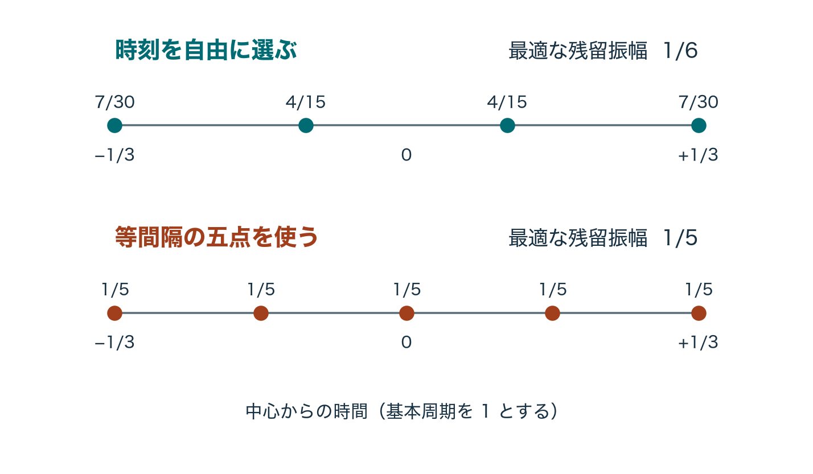
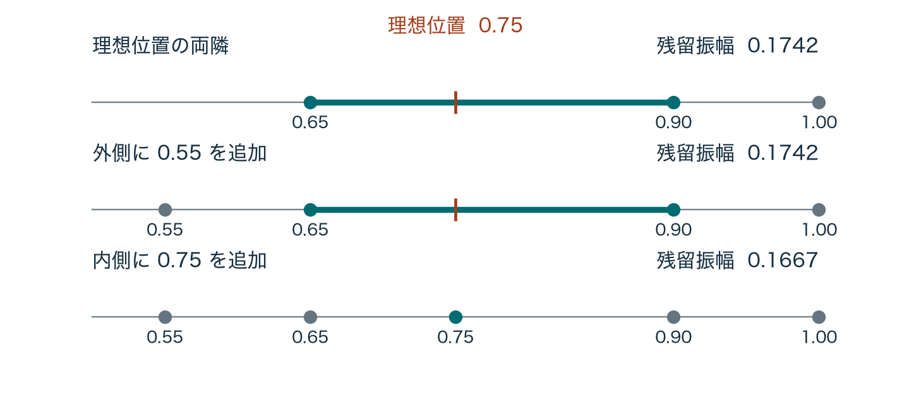

# 振動を抑えるには、時計の目盛りをどこに置けばいいか？

## Abstract

周波数比が 1:2:3 の三つの振動を、同じ観測時刻と非負の重みで平均するとき、最も大きく残る振幅をどこまで抑えられるかを調べた。観測時刻を自由に選べる場合の最適値を、すべての観測時間について Lean で証明した。たとえば、最も遅い振動の周期（基本周期）の 2/3 を使うと、自由に選んだ四点では元の振幅の 1/6 を達成できるが、両端を含む等間隔の五点では 1/5 が限界になる。さらに同じ時間幅で、両端を含む左右対称な時計の目盛りが本文の条件を満たせば、理想の観測時刻を挟む二つの目盛りだけから、残留振幅が 1/6 よりどれだけ増えるかを厳密に計算できる。この損失式も Lean で証明した。数学としての初出は未確認である。

## 同じ時間幅で四点と五点を比べる

図の横軸が観測時刻、点の上の数字がその時刻の測定値に掛ける重み。重みはすべて非負で、合計を 1 にする。元の振幅をそれぞれ 1 として、各振動の開始位置をどうずらしても、平均後に残りうる最大の振幅を比べている。**1/6 から 1/5 への差は元の振幅の 1/30。残った振幅を基準にすると 20% 増える。**

## なぜ五点では 1/5 が限界なのか

基本周期を角度の一周に換算すると、五つの目盛りは −120°、−60°、0°、60°、120°。この五点では、次の関係がすべての点で成り立つ。

$$
2\cos t-2\cos(2t)+\cos(3t)=1.
$$

たとえば 60° では、三つのコサインの値は順に 1/2、−1/2、−1。左辺は確かに 1 になる。五点のどれでも右辺が 1 だから、どんな重みで平均しても、この式の右辺は 1 のままだ。

仮に三つの振動をすべて振幅 $d$ 以下にできたなら、左辺の平均の絶対値は最大でも $2d+2d+d=5d$。したがって $d$ は 1/5 以上になる。実際、五点に等しい重みを置くと三つのコサインの平均は $+1/5,-1/5,+1/5$ になり、左右対称なのでサインの平均はすべてゼロになる。これで、どの開始位置でも 1/5 を達成できる。[五点の Lean 証明](../../lean/Leanmath/HarmonicGrid.lean#L136-L144)

## 不等間隔の時計でも、どの二点を見ればよいか

時刻を自由に選べるとき、四点の最適な配置は両端の ±120° と、内側の約 ±41.41°。この角度が現れる理由は、内側の理想位置が $\cos t=3/4$ を満たすことにある。[連続時間の証明](../../lean/Leanmath/HarmonicResidual.lean#L36-L136)

目盛りが中心から左右対称に配置され、両端も使えるとする。各目盛りを $z=\cos t$ に変換すると、左右の対は同じ値になる。得られた値を小さい順に並べ、**理想値 3/4 を挟む隣り合う値**を $a,b$ とする。$1/2\le a\le 3/4\le b\le1$ かつ $a<b$ なら、残留振幅の最小値は次の通り。

$$
\frac16 + \frac{8(3/4-a)(b-3/4)}{3(3+4ab)}.
$$

第2項が、時計の目盛りに合わせることで増える分だ。理想位置に目盛りを足すと片方の差がゼロになり、1/6 に戻る。逆に、二点の間を空けたまま外側にいくつ目盛りを足しても、最適値は変わらない。図の五点では $z$ の値が −1/2、1/2、1 なので、式に $a=1/2$、$b=1$ を入れると 1/5 になる。条件を外すとこの式が破れる反例もある。[一般の Lean 証明](../../lean/Leanmath/HarmonicGrid.lean#L26-L134) · [反例と追試手順](../../research_notes/Minimum%20Width%20Applications/harmonic-novelty-audit.md)

この図は $z=\cos t$ の 0.50 から 1.00 の部分を拡大したもの。どの段でも区間の両端（$z=-1/2$）を使える。太線が理想位置を挟む区間で、右側の数値は上の式を小数第4位に丸めた。

## 何が既知で、何が新規性候補か

| 問い | 分かったこと | 先行研究との関係 |
| --- | --- | --- |
| 観測時刻を時計の目盛りに合わせると、どれだけ損をするか | 上の条件下では、隣の二点から損失を厳密に計算できる。 | **最有力候補。** 固定した目盛り上での数値最適化と、隣接点を使う証明手法には先行研究がある。 |
| 自由に時刻を選べるなら、観測時間に応じてどこまで抑えられるか | 半周期で 1/3、2/3 周期で 1/6、3/4 周期で初めてゼロ。全時間幅の最適値を式にできる。 | **もう一つの候補。** 完全に消せる時間の境界は既知。候補は、そこに至るまでの残留振幅も含めた式。 |

固定時刻での振動抑制、離散的なモーメント問題、三角多項式の先行研究を照合した。調べた一次資料では同じ損失式を明示したものは見つからず、数学としての初出は未確認である。ここで扱った周波数比は厳密に 1:2:3 で、証明にリーマン予想は使わない。[入力整形の先行研究](https://citeseerx.ist.psu.edu/document?doi=3453580e3a8cb1cd61a4a759e91e00da041149c2&repid=rep1&type=pdf) · [離散モーメント問題](https://arxiv.org/abs/1504.02989) · [完全相殺の境界に対応する定理](https://arxiv.org/pdf/math/0601021)

**応用例。** 等間隔の四つの周波数を測定データから区別したいとき、どの二つが最も似て見えるかを「最大相関」で測れる。四つの周波数から二つ選んだときの差は 1、2、3 のいずれかなので、測定行列の四列の最大相関を最小にする問題にも同じ式が使える。[対応する行列と導出](../../research_notes/Minimum%20Width%20Applications/harmonic-novelty-audit.md#which-parts-follow-from-earlier-mathematics)

**検証。** 連続時間の最適値、有限の目盛りでの損失式、五点の例を Lean で `sorry` なしに証明した。独立した線形計画による追試では、不等間隔の目盛りを 96 組試し、損失式から求めた最適値との差は最大 $6.72\times10^{-15}$ だった。[追試コード](../../explore/harmonic_residual_check.py) · [英語の研究ログ](../../research_notes/Minimum%20Width%20Applications/harmonic-novelty-audit.md)
