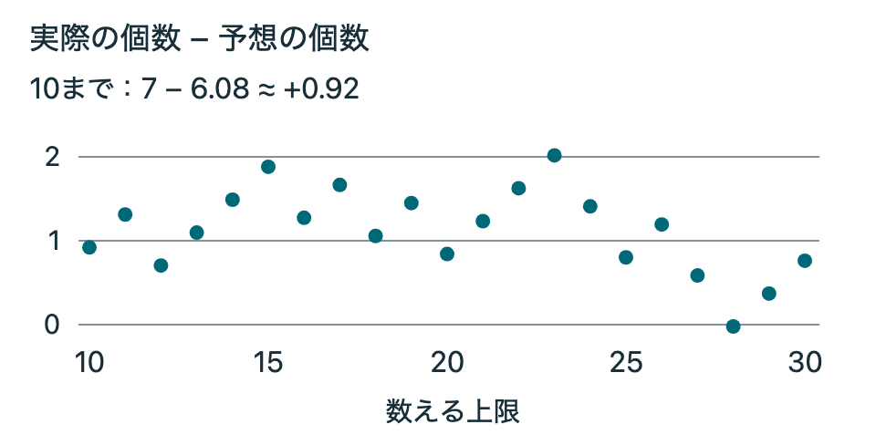
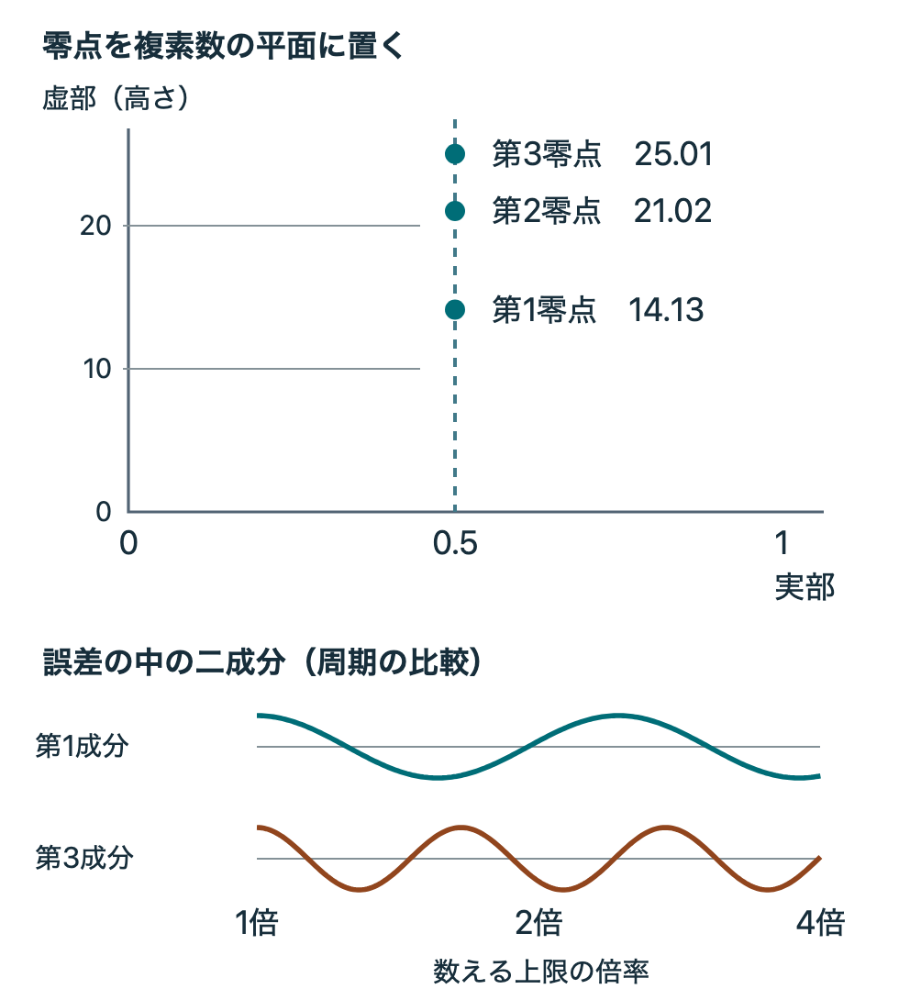
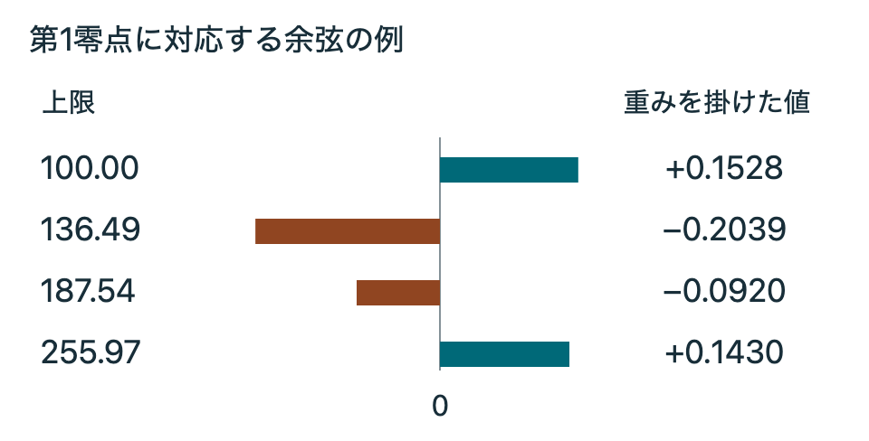
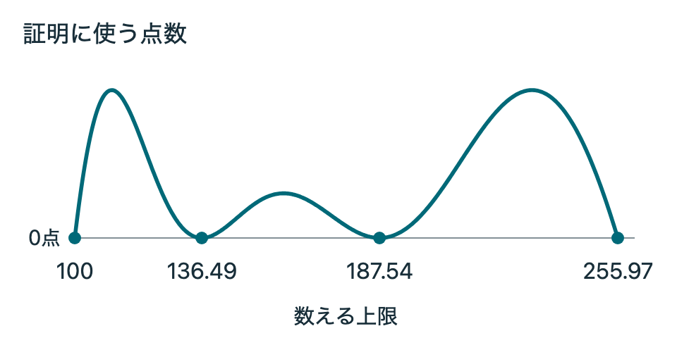

# 整数の個数は予想からどれだけずれる？　四回の平均で取り除けるもの

1から10までの整数のうち、4、9、16、25、…のような平方数で割り切れるものを除くと、1、2、3、5、6、7、10 の **7個** が残ります。この仲間は長い目で見ると全体の約60.8%なので、10までなら予想は約6.08個。実際に数えた方が **0.92個分多い** わけです。

## 上限を変えると、予想の外れ方はどう変わる？

11まで数えると11が加わり、実際は8個、予想は約6.69個で、ずれは **+1.31**。12は4で割り切れるので、12まで数えても実際は8個のままです。予想は約7.30個に増え、ずれは **+0.70** に縮みます。

この点列が、実際に観測できる**ずれ全体**です。これを数式で調べると、上限を一定の倍率で動かすたびに山と谷を繰り返す成分が現れます。ここでいう「波」は、そうした**一つの周期成分**です。形は滑らかなサインやコサインで、周期の違う成分が同じずれの中に重なっています。

たとえばある成分が、一回目のずれに +2、二回目に −2 だけ寄与したとします。二回の平均では、この成分の寄与は (+2 − 2) ÷ 2 = 0 です。別の成分が同じ二回で +1、+1 なら、そちらの寄与は平均しても +1 残ります。**「消す」とは、選んだ成分が平均結果に足す分をゼロにすることです。**

今回選んだのは、最初の三つのゼータ零点に対応する、速さの違う三成分です。**数える上限を100、約136.49、約187.54、約255.97の四か所に取ると、同じ平均で三成分の寄与を一つずつゼロにできます。** 最初を100に固定して250で止めると、途中の測定を何回増やしても三成分には同時に効きません。100は説明のために選んだ出発点です。四つの上限すべてを同じ倍率で移しても、必要な範囲は最初の上限の約2.55970倍で、混ぜる割合も共通です。

## ゼータ零点って、何がゼロになるの？

たとえば関数 <i>f</i>(<i>x</i>) = <i>x</i>² − 4 は、2を入れても −2 を入れても答えが0です。この **答えを0にする入力** を、その関数の「零点」と呼びます。ゼータ零点も同じで、リーマンのゼータ関数 ζ（ゼータ）に入れると答えが0になる数です。

ゼータ関数の出発点は足し算です。たとえば ζ(2) は 1 + 1/2² + 1/3² + 1/4² + ⋯ で、ζ(3) なら各分母の指数が3になります。この足し算が収束する範囲から、元の値とつじつまが合うように関数を広げると、複素数の平面のほぼ全体で値が定まります。零点を調べるときは、この広げた関数を使います。[ゼータ関数の定義（NIST）](https://dlmf.nist.gov/25.2)

図の上半分では、複素数 <i>a</i> + <i>bi</i> を、横に <i>a</i>、縦に <i>b</i> 進んだ点として描きます。たとえば最初の青緑の点は、横がちょうど ½、縦が約14.13。これは「½ + 14.1347… × <i>i</i> を入れると、ゼータ関数の値が0になる」という意味です。[零点の数値表（LMFDB）](https://www.lmfdb.org/zeros/zeta/list?limit=3&N=1)

ゼータ関数には −2、−4、−6、…という規則的な零点もあり、これを「自明な零点」と呼びます。それ以外の零点を「非自明な零点」と呼びます。リーマン予想が述べているのは、**非自明な零点がすべて、横の座標が ½ の縦線に並ぶ**ということです。[零点とリーマン予想（NIST）](https://dlmf.nist.gov/25.10)

今回の波の速さを決めるのは、それぞれの点の**縦の座標**です。図の下半分では、左から中央へ進むと数える上限が2倍になり、中央から右へ進むとさらに2倍になります。同じ距離を進む間に、高さ25.01の点に対応する波は、高さ14.13の点に対応する波より多く山と谷を通ります。

一つの成分だけなら、半周期進むと値の符号が逆になるので、二回の平均で寄与を0にできます。その二倍の速さの成分は、同じ間に一周して元の値に戻ります。三つの速さすべてに効く平均を見つけるには、上限の選び方と混ぜる割合を一緒に決める必要があります。

## 四回の測定をどう混ぜる？

最初の上限を100にすると、四回で足ります。次の上限は約136.49です。136まででも136.49まででも整数の個数は同じですが、「上限の約60.8%」という予想値は少し変わります。だから、予想からのずれを測る場所は小数で選べます。

各回で「実際の個数 − 予想の個数」を求め、数える上限の四乗根で割って、大きさの尺度をそろえます。この四つの値を次の割合で平均します。

| どこまで数えるか（概数） | 平均に入れる割合（概数） |
| ---: | ---: |
| 100.00 | 15.28% |
| 136.49 | 34.72% |
| 187.54 | 34.72% |
| 255.97 | 15.28% |

一番遅い成分だけを取り出し、100での値を山の頂上の +1 にそろえて計算してみます。下図の棒は、四か所それぞれの余弦の値に、すでに表の割合を掛けたものです。

丸める前の数で足すと、この成分が平均に残す分は0です。山の途中から始めても同じで、第2、第3の成分も**まったく同じ四か所・同じ割合**で、それぞれ寄与が0になります。一方、四か所で実際に整数を数え、上で説明した通りにずれの尺度をそろえて平均すると **+0.15841** が残ります。他の成分なども含む、ずれ全体の平均だからです。

## なぜ250で止めると足りない？

では、最後を250にして、もっと細かく測ったらどうでしょう。ここで効くのが、**0点以上の点数ばかりのとき、平均点が0点なら、平均に入れた全員が0点だったはず**という理屈です。

証明では、三つの波を足し合わせて、各観測位置に「点数」を付けます。点数の平均は、三つの波をすべて消せば必ず0です。一方、100から約255.97まででは、ちょうど表の四か所だけが0点で、それ以外はすべてプラスになることを、丸め誤差を含めた計算で確かめられます。

すると、途中の別の場所を平均に加えた瞬間に、平均点はプラスになってしまいます。残った四か所で三つの波を消す条件を解くと割合も表の値に決まり、両端とも必要です。これで250で止める案も、千か所で測る案もまとめて判定できます。

## 今回の新規性はどこにある？

整数の個数の誤差にゼータ零点が関わることは、以前から研究されています。また、機械の振動を抑える工学では、三種類の振動に合わせて四回の操作の時刻と強さを選ぶ例が2005年に発表されています。[整数の誤差の先行研究](https://arxiv.org/abs/1912.04972)・[三種類の振動を四回の操作で抑える先行研究（第III節・図5）](https://doi.org/10.1109/TMECH.2005.856217)

今回の三零点の結果には、二つの向きの証拠があります。**四か所の表は「ここまで広げれば足りる」証拠です。点数の図とその符号の証明は「どんな平均も、少なくともここまでは必要」という証拠です。** 後者では、測る回数を四回と決めていません。区間全体に連続的に重みを配る方法まで含めて、各場所を混ぜる割合がすべて0以上の平均を調べています。

二つの境目が一致したので、最初の三つのゼータ零点については、必要な倍率が約 **2.55970倍** と決まります。しかも、最初の上限を決めたら、その最小範囲で使える場所も混ぜる割合も一通りです。**この三つの具体的な周波数について、もっとよい方法が存在しないところまで確かめた**ことが、今回の新規性の候補です。丸め誤差を含めて検査する計算機援用の証明があり、同じ結論が世界で初めてかどうかは確定していません。

## 平均から取り除く成分を増やすと、どうなる？

零点を描いた図に、高さ T で横線を引くとします。今度は、高さが正で、その線までに入る零点に対応する波をすべて消す場合を考えます。

必要な倍率は「最後の上限 ÷ 最初の上限」です。三成分なら約2.55970倍で、その倍率の自然対数を研究では最小幅 L(T) と呼びます。

通常のリーマン予想を仮定した紙上の証明案では、十分大きい T に対し、必要な倍率は **T² の定数倍の範囲**に収まります。具体的な平均の作り方が与える上限と、どんな平均にも必要な下限の比は、T を大きくした極限で4です。三成分の場合のように上限と下限が一致するか、一般の場合にはまだ分かっていません。

## 誤差の中から、小さな補正を読み取れる？

ここからは、五つの零点を使った別の計算例です。先ほどは整数を一個ずつ数え、四回の観測を混ぜました。ここでは一回の観測の中でも、境目の近くで整数一個一個に付ける重みをなめらかに変えます。次に、いくつかの規模で得た合計を混ぜます。数えたい規模ごとに混ぜ方を選ぶと、指定した零点から来る揺れが消え、その奥にある小さな補正を式で取り出せます。

規模を192にした例では、よく知られた割合から出る見積もりは **116.72200**。今回の式で補正すると **116.72956**。整数を実際にふるい分けて同じ重みで足すと **116.72955** でした。

同じ「いくつもの波をいつ測れば消せるか」という問いは、量子系の待ち時間にも現れます。エネルギーが等間隔に四段あり、共通の時計が少し速くても遅くても、そのずれに比例する分まで打ち消すなら、一番遅い波の1.5周期が最短の締切です。こちらはリーマン予想を使わずに紙上で導けます。

三零点の数値と最短性には、公開された零点の数値範囲を入力にした計算機援用の証明があります。一般の高さの結果と量子系への応用は紙上での導出です。これらの成果の Lean による形式検証、外部査読、世界で最初かどうかの確認は未了です。[零点の数値表](https://www.lmfdb.org/zeros/zeta/)

## 自分で確かめる三問

三成分の寄与がそれぞれ0になったら、実際に数えた個数は予想と一致する？

ほかの成分も残ります。実際に整数を数えた例では、尺度をそろえたずれの平均は +0.15841 でした。

100から250の間で観測を百回に増やしたら、四回の方法を追い越せる？

同じ三つの波を正の割合で平均する限り、できません。平均点を0にできる位置は四か所に限られ、その中で最後の約255.97にも正の割合が必要です。

116.72955は、1から192までに条件を満たす整数が何個あるかを表している？

これは重み付きの合計です。規模を192として各整数の寄与を小数で加えたもので、通常の個数は整数になります。

