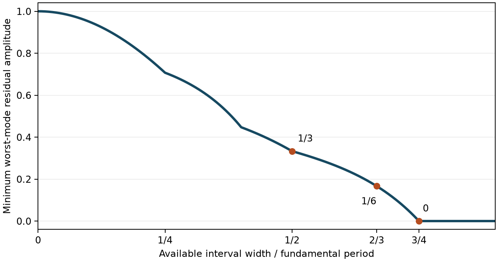

# How much of three harmonics must survive a short positive average?

With two thirds of one fundamental period available, the smallest possible worst residual at harmonics 1, 2 and 3 is exactly **1/6** of unit amplitude. Four positive samples attain it. Every probability distribution on any interval of that width leaves at least that much of one of the three modes. The same optimization admits an explicit solution for every time budget.



## Statement and construction

Normalize the fundamental angular frequency to 1. Write 2r for available duration and μ for a probability measure on an interval of that length. At mode k the residual is the largest absolute value of the averaged unit cosine over its starting phase, equivalently the magnitude of the k-th Fourier coefficient of μ. Define E(r) by minimizing the largest of the three residuals over μ. Translation only changes the phases, so the interval center is free.

With l = cos r the answer is

| Radius r | E(r) |
| --- | --- |
| 0 ≤ r ≤ π/2 | max{l, (2l+1)/(2l+3), 4l(1+l)/(4l(1+l)+2)} |
| π/2 ≤ r ≤ 3π/4 | (1−2l²)/(3−2l−4l²) |
| 3π/4 ≤ r | 0 |

The formulas agree at both boundaries. In physical units for angular frequencies ω, 2ω, 3ω and duration D, insert r = ωD/2. The construction gives a positive undamped three-mode input shaper for each prescribed duration and an exact benchmark for numerical designs. This application concerns the normalized residual for each mode separately. [Lean definition and theorem](../../lean/Leanmath/HarmonicResidual.lean) · [Specified-duration input shaping](https://pmc.ncbi.nlm.nih.gov/articles/PMC9704665/)

At r = 2π/3 the optimal schedule can be written in two rows. To start the clock at zero, add r to all four times.

| Centered observation times | Weight at **each** time |
| --- | --- |
| ±arccos(3/4) | 4/15 |
| ±2π/3 | 7/30 |

Reflection symmetry makes the sine moments zero. The three cosine moments are +1/6, −1/6 and +1/6. A sharp lower bound takes only one cubic identity. For z = cos t, centered time t lies in [−2π/3, 2π/3], so z ≥ −1/2 and

$$
18\cos t-16\cos(2t)+8\cos(3t)-7
=32(z+1/2)(z-3/4)^2\ge 0.
$$

If every mode has amplitude at most d, integrating gives 7 ≤ (18+16+8)d. This works for asymmetric laws too, since the error bound applies to the centered cosine at each frequency. The two roots of the polynomial give the four observation times in the table.

## How the rest of the curve follows

For r ≤ π/2 the variable z ranges from l to 1. The functions 2z²−1 and 4z³−3z are convex there. Their secant lines between l and 1 bound them from above. Together with the first moment bound these give the three entries in the maximum. An endpoint mixture in z attains that maximum, corresponding to at most three times, 0 and ±r.

For π/2 ≤ r ≤ 3π/4 put x = −l, v = (1+x)/(1+2x) and e = E(r). The optimizer puts total weight (e+x)/(v+x) at the inner pair ±arccos v and the rest at ±r, splitting each pair equally. Its three signed moments are (e, −e, e). Expanding the nonnegative cubic (z+x)(z−v)² gives the matching lower bound. At r = 3π/4 all three moments vanish, and the same measure fits in every wider interval. [Proof and constructions](../../lean/Leanmath/HarmonicResidual.lean)

## Near-optimal distributions

At r = 2π/3 the lower-bound polynomial also controls how far an arbitrary near-optimal law can spread. If its three residuals are at most 1/6 + η, put Z = cos(t−c), with c the center of the containing interval. For every d > 0,

$$
\Pr\{Z+1/2\ge d,\ |Z-3/4|\ge d\}
\le \frac{21\eta}{16d^3}.
$$

The distances in this inequality are measured on the cosine coordinate. For example, at most 0.84% of the mass can be at least 1/4 away from both optimal cosine values when η = 0.0001. At η = 0 the law is supported on the four listed times up to translation. The proof integrates the displayed cubic, then applies Markov's inequality. [Lean statement](../../lean/Leanmath/HarmonicResidual.lean)

## Prior work and scope

Kozma and Oravecz's Theorem 2 at N=1, K=2 gives the zero-error endpoint in the dual formulation. Yang and Xie give a general test for prescribed trigonometric moments of positive measures on an arc. That framework can express the present optimum as a convex optimization problem. Specified-duration input shaping is also an established engineering problem. The research claim being tested here is narrower: an attained closed-form minimax curve for the first three harmonics over all positive laws, together with the explicit near-optimal mass bound. The searches on trigonometric moment minimax problems, Fourier coefficients of arc-supported probability measures and multimode input shaping did not locate a publication giving this same curve. Priority remains open. The mathematical result uses mathlib and elementary trigonometry; it has no zeta-zero or RH hypothesis. [Kozma–Oravecz, Theorem 2](https://arxiv.org/pdf/math/0601021) · [Yang–Xie](https://doi.org/10.1016/j.sigpro.2017.07.024) · [Specified-duration shapers](https://pmc.ncbi.nlm.nih.gov/articles/PMC9704665/)

## Reproduction

From the experiment directory:

```sh
(cd lean && lake build Leanmath.HarmonicResidual)
(cd lean && printf 'import Leanmath.HarmonicResidual\nopen Leanmath.ZetaWidth\n#print axioms harmonic_error_curve_exact\n#print axioms two_thirds_pi_residual\n#print axioms near_optimal_harmonic_mass\n' | lake env lean --stdin)
uv run --script explore/harmonic_residual_check.py
```

The independent LP optimizes nonnegative masses on 513 uniformly spaced times in [0,r], reflecting each mass across zero. Symmetrizing any law about the midpoint keeps its centered cosine moments and removes its sine moments, so this restriction to symmetric laws still permits an optimum. Across 98 sampled radii from 0 to π the grid optimum minus the closed formula ranged from −1.11 × 10⁻¹⁶ to 1.95 × 10⁻⁶. The four-point example also passes an exact rational moment check. The Lean proof supplies the continuous optimum. [Cross-check script](../../explore/harmonic_residual_check.py)

To regenerate the figure, add `--with matplotlib` after `uv run` and pass `--plot 'research_notes/Minimum Width Applications/harmonic-residual.png'` after the script path.

The [novelty audit and exact finite-clock penalty](harmonic-novelty-audit.md) compare these claims with classical moment theory and determine how much residual is added when the ideal times fall between clock ticks.
