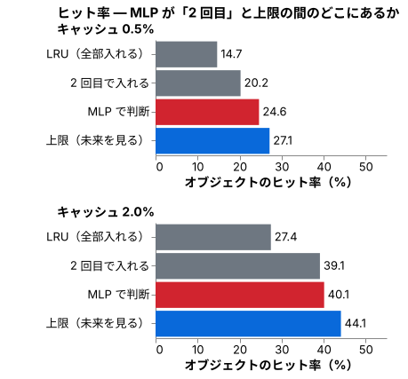
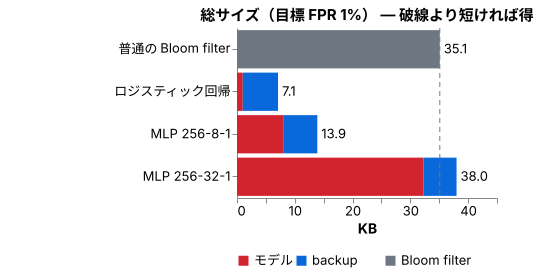

# この判断に、小さな ML を入れてよいか

<!-- persona: personas/mizchi.md -->

> 想定読者：キャッシュやフィルタの判断を、フレームワーク無しの小さなモデルに置き換えたい人（mizchi）。
> 省いたもの：ML の入門、実験コードの全文（[../README.md](../README.md) と `ts/`・`rust/`）。
> 所要 15 分。
> 本文の出力はすべて `checks.json` で再実行して照合し、図は `figure-check.mjs` で検査しています（付録）。

この資料は、mizchi に次のことを伝えます。
小さな ML は「正解が後から自動で分かり、外れても古典的な仕組みが正しさを守る判断」にだけ入れる。
効果は、単純なルールと未来を見た上限の間で測る。
問い合わせの分布が学習時と変わると、ML の数字は保証にならない。

| 節 | 役割 | 見せるもの | なぜ |
|---|---|---|---|
| 0 | 入れるかを 4 つの質問で決める | 判断の図 | 持ち帰る形 |
| 1 | ML は判断だけ、正しさは古典構造 | learned Bloom filter の図と出力 | 外れても壊れない形を知る |
| 2 | 効果は 2 本の線で挟んで測る | キャッシュのヒット率 | 上乗せを過大に見ない |
| 3 | モデルは総コストで選ぶ | Bloom filter のサイズ | 「大きいほど良い」を外す |
| 4 | 壊れる条件を先に知る | 分布シフトと XOR の出力 | 入れてはいけない場面 |
| 5 | 自作の逆伝搬は数値微分で確かめる | 逆伝搬の図と抜粋 | フレームワーク無しで作る条件 |
| 6 | 同じ型が本番で効いた例 | 表 | 自分の題材に当てはめる |

---

## 0. 一枚で：入れる前の 4 つの質問

| # | 質問 | 「いいえ」なら | 節 |
|---|---|---|---|
| 1 | 判断の正解は、ログから後で分かるか | 効果を測れない。入れない | [2](#2-効果は単純なルールと上限で挟んで測る) |
| 2 | 外れても、正しさを守る仕組みがあるか | 先にその仕組みを作る | [1](#1-ml-は判断だけ正しさは古典的な仕組みが守る) |
| 3 | 上限と単純なルールの差は大きいか | 単純なルールで済ませる | [2](#2-効果は単純なルールと上限で挟んで測る) |
| 4 | 推論は、判断で節約できる時間より十分速いか | 入れない | [4](#4-壊れる条件分布が変わる線形で分けられない) |

4 つとも「はい」なら、ロジスティック回帰から試します。



---

## 1. ML は判断だけ、正しさは古典的な仕組みが守る

Bloom filter の前に、学習したモデルを置く例です（learned Bloom filter）。
鍵の集合は「怪しい URL」3 万件で、問い合わせの大半は普通の URL です。



backup には、モデルが τ 未満と判定した鍵だけを入れます。
**どの鍵も「スコアが τ 以上」か「backup にある」のどちらかなので、偽陰性は構造上 0 になります。**
モデルがいくら外れても、外れ方は偽陽性（遅くなる・余計に調べる）にしかなりません。

<!-- output: bloom -->
```
plain Bloom: 35.1 KB
--- logistic regression: 257 params (1.0 KB as f32)
  target 1.000%: total 7.1 KB
    model 1.0 KB + backup 6.1 KB (4805 keys)
    test FPR=1.059%  shifted FPR=84.115%
    FN=0
```

同じ偽陽性率 1% で、35.1 KB が 7.1 KB になりました。
backup に入ったのは 4805 件で、鍵の約 16% です。
実験では、見た目では判別できない鍵を 15% 混ぜてあり、それがほぼそのまま backup に回っています。

キャッシュも同じ形です。
admission（入れるか）を外しても、起きるのはキャッシュミスだけで、返す値は変わりません。

---

## 2. 効果は、単純なルールと上限で挟んで測る

キャッシュに「入れるかどうか」を MLP（209 パラメータ）で決めた結果です。
ラベルは「H リクエスト以内にもう一度来たか」で、トレースから自動で付きます（質問 1 の「はい」）。



<!-- output: cache -->
```
=== cache = 0.5% of unique bytes
LRU (admit all)                 14.66%
LRU + doorkeeper (2nd hit)      20.23%
LRU + MLP admission p>0.5       24.62%
LRU + oracle admission          27.13%
=== cache = 2.0% of unique bytes
LRU + doorkeeper (2nd hit)      39.12%
LRU + MLP admission p>0.5       40.12%
LRU + oracle admission          44.12%
```

LRU だけと比べると、MLP はどちらの容量でも大きく勝って見えます。
しかし「2 回目のアクセスで入れる」という 1 行のルール（doorkeeper）と比べると、容量 2% では差は 1 ポイントです。

**比べる相手は、LRU ではなく単純なルールです。**
上限（未来を見て、また来るものだけ入れる）は、どの admission でも越えられない線です。
容量 0.5% では、ルールと上限の差 6.9 ポイントのうち 4.4 ポイントを MLP が埋めました。
容量 2% では差が 5.0 ポイントあり、MLP が埋めたのは 1.0 ポイントです。

この実験は合成データで、特徴量が効くように作ってあります。
実データでは、上限とルールの差を先に測り、差が小さければ ML を入れずに済ませます。

---

## 3. モデルは、精度ではなく総コストで選ぶ

learned Bloom filter で、モデルの大きさを変えた結果です。



<!-- output: bloom -->
```
--- MLP 256-8-1: 2065 params (8.1 KB as f32)
  target 1.000%: total 13.9 KB
    model 8.1 KB + backup 5.8 KB (4524 keys)
--- MLP 256-32-1: 8257 params (32.3 KB as f32)
  target 1.000%: total 38.0 KB
    model 32.3 KB + backup 5.7 KB (4540 keys)
```

MLP にすると backup の鍵は 4805 件から 4524 件に減りますが、モデルが 8 倍に増えます。
32 ユニットにすると、普通の Bloom filter（35.1 KB）より大きくなりました。

**大きいモデルの精度の上乗せは、モデル自体の大きさで消えます。**
Rust 版で重みを int8 にすると、ロジスティック回帰のモデルは 1.0 KB から 0.3 KB になり、偽陽性率はほぼ変わりません。

<!-- output: rust-bloom -->
```
logreg f32: total 6.9 KB
  model 1.0 KB + backup 5.9 KB
  test FPR=0.994%
logreg int8: total 6.2 KB
  model 0.3 KB + backup 6.0 KB
  test FPR=1.041%
```

---

## 4. 壊れる条件：分布が変わる、線形で分けられない

1 節の出力の `shifted FPR` は、「怪しい見た目だが鍵集合には無い URL」を問い合わせたときの偽陽性率です。

<!-- output: bloom -->
```
plain Bloom: 35.1 KB
  test FPR=1.028%  shifted FPR=1.070%
...
--- logistic regression: 257 params (1.0 KB as f32)
  target 1.000%: total 7.1 KB
    test FPR=1.059%  shifted FPR=84.115%
```

普通の Bloom filter は、どんな問い合わせでも 1% のままです。
learned 版は 84% になりました。

**learned 版の「1%」は、問い合わせが学習時と同じ分布から来る、という条件付きの数字です。**
攻撃者が問い合わせを選べる場面（ブロックリスト、レート制限）では、この条件が崩れます。

もう 1 つの壊れ方は、モデルの形です。
分岐予測の実験で、1 層のパーセプトロンは 20 分岐前の結果を完全に使えますが、2 つの分岐の XOR は当てられません。

<!-- output: branch -->
```
= R (next)
  bimodal       49.9%
  gshare 12bit   1.0%
  gshare 16bit   1.3%
  perceptron     0.0%
= R xor S (next)
  bimodal       49.9%
  gshare 12bit   5.3%
  gshare 16bit   3.7%
  perceptron    49.5%
= R (~20 branches later)
  bimodal       49.9%
  gshare 12bit  49.9%
  gshare 16bit  49.8%
  perceptron     0.0%
```

数字は誤予測率です。bimodal と gshare（履歴 12bit / 16bit）は、古典的な分岐予測器です。
XOR の行だけ、パーセプトロンが 49.5%（当て推量と同じ）になりました。
隠れ層が要るのは、この形の相互作用があると分かったときです。

推論の速さ（質問 4）も、ここで効きます。
TS 版の learned Bloom filter は 1 問い合わせ約 4µs で、普通の Bloom filter（約 250ns）の 15 倍以上です（時間は回ごとに変わるので照合していません）。

---

## 5. 自作の逆伝搬は、数値微分で確かめる

隠れ層 1 つの MLP では、逆伝搬は次の順に計算します。



出力を sigmoid、損失を交差エントロピーにすると、出力の誤差は `p - y` だけになります。

<!-- source: ../ts/src/nn.ts -->
```ts
    const p = this.predict(x, offset);
    const L = this.W.length;
    this.deltas[L - 1][0] = (p - y) * weight;
```

隠れ層へは、重みの転置を掛け、ReLU が 0 にした所を消して戻します。

<!-- source: ../ts/src/nn.ts -->
```ts
      if (l > 0) {
        const prev = this.deltas[l - 1];
        for (let i = 0; i < nin; i++) {
          // ain[i] > 0 ⇔ ReLU が通した (= 微分が 1)
          if (ain[i] <= 0) { prev[i] = 0; continue; }
          let s = 0;
          for (let o = 0; o < nout; o++) s += w[o * nin + i] * delta[o];
          prev[i] = s;
        }
      }
```

ここに誤りがあっても、学習は止まりません。
「少し遅い」「精度が少し低い」としか見えないので、出力を眺めても気づけません。

確かめ方は 1 つで、重みを 1 つずつ ±h 動かして損失の差を取り、逆伝搬の勾配と比べます。

<!-- source: ../ts/src/gradcheck.ts -->
```ts
    p[i] = orig + h; const lp = totalLoss();
    p[i] = orig - h; const lm = totalLoss();
    p[i] = orig;
    const num = (lp - lm) / (2 * h);
```

<!-- output: gradcheck -->
```
gradient check: max relative error = 3.07e-9 (79 params)
XOR: 0.000 1.000 1.000 0.000
OK
```

相対誤差 3e-9 で一致し、XOR も学習できました。
フレームワークの自動微分を使わないなら、このテストが自動微分の代わりです。

---

## 6. 同じ型が本番で効いた例

どれも「正解が後で分かる」「外れても既存の仕組みが守る」「モデルは小さく、ランタイムにフレームワークを持ち込まない」を満たしています。
数字は論文の報告値で、この資料では再現していません。

| 事例 | 判断 | 後から分かる正解 | 外れたとき | 報告された効果 |
|---|---|---|---|---|
| パーセプトロン分岐予測（Jiménez & Lin, HPCA 2001） | 分岐するか | 実際に分岐したか | パイプラインをやり直す | AMD Zen 系の CPU に載っている |
| [LRB](https://www.usenix.org/conference/nsdi20/presentation/song)（NSDI 2020） | CDN で何を追い出すか | 次にいつ来たか | キャッシュミス | WAN トラフィック 4〜25% 減 |
| [Baleen](https://www.usenix.org/conference/fast24/presentation/wong)（FAST 2024, Meta） | フラッシュに入れるか | また読まれたか | HDD から読む | ピークのディスク時間 12% 減 |
| [LinnOS](https://www.usenix.org/conference/osdi20/presentation/hao)（OSDI 2020） | この I/O は遅いか | 実際に遅かったか | 別のレプリカに回す | 回帰でなく二値分類にして、カーネル内で推論 |
| [MLGO](https://arxiv.org/abs/2101.04808)（Google, LLVM） | インライン化するか | できたバイナリの大きさ | サイズが少し増える | `-Oz` 比でサイズ 3〜7% 減 |

LRB と Baleen はモデルに勾配ブースティング木を使っています。
表形式の特徴量では、MLP より強いことが多い形です（手で書くのは MLP より重い）。

---

## 7. 入れるときのチェックリスト

| 確かめること | この資料の例 |
|---|---|
| 単純なルールの値と、上限の値を先に測った | 2 節：doorkeeper と oracle |
| ML の効果を、LRU ではなく単純なルールとの差で書いた | 2 節：容量 2% で +1.0 ポイント |
| 外れたときの行き先が、正しさを壊さない | 1 節：backup、キャッシュミス |
| モデルの大きさを、残りの仕組みと合わせた総コストで比べた | 3 節：7.1 KB と 38.0 KB |
| 学習時と違う分布の問い合わせで、別に測った | 4 節：shifted FPR |
| 逆伝搬を自作したら、数値微分で確かめた | 5 節：gradcheck |
| 時系列で分けて評価した（過去で学習、未来で評価） | 2 節：先頭 30% で学習 |

---

## 8. 理解度チェック

1. learned Bloom filter の偽陽性率が検証データで 1% だった。これをブロックリストに使ってよいか。

<details>
<summary>答え</summary>

条件付きでしか使えない。
1% は「問い合わせが学習時と同じ分布から来る」ときの値で、怪しい見た目の URL を問い合わせると 84% になった（4 節）。
攻撃者が問い合わせを選べる用途では、普通の Bloom filter の保証とは別物になる。

</details>

2. キャッシュの admission を MLP にしたら、LRU よりヒット率が 13 ポイント上がった。これは ML の効果か。

<details>
<summary>答え</summary>

大半は ML の効果ではない。
容量 2% では、1 行のルール（2 回目で入れる）が 11.7 ポイントを取っていて、MLP の上乗せは 1.0 ポイントだった（2 節）。
比べる相手は単純なルールで、上限との差で残りの余地を見る。

</details>

3. learned Bloom filter が鍵を「ない」と答えることはあるか。

<details>
<summary>答え</summary>

無い。
スコアが τ 未満の鍵はすべて backup に入れてあるので、どの鍵も「スコアが τ 以上」か「backup にある」のどちらかになる（1 節の図）。
出力の `FN=0` がこれを示している。

</details>

4. 手書きの MLP の学習が、思ったより遅い。逆伝搬のバグを疑うとき、まず何をするか。

<details>
<summary>答え</summary>

数値微分の勾配と比べる（5 節）。
逆伝搬の誤りは学習を止めず、「遅い」「少し悪い」としか見えないので、出力からは判定できない。

</details>

5. 隠れ層を足すべきなのはどんなときか。

<details>
<summary>答え</summary>

線形モデルで分けられない相互作用（XOR の形）があると分かったとき。
分岐予測では、パーセプトロンは長い履歴を使えたが、XOR は 49.5% で当て推量と同じだった（4 節）。
そうでないなら、3 節のとおり大きいモデルはサイズで損をする。

</details>

---

## 付録：再現

```sh
cd 2026-11-23-tiny-ml-for-systems/explainer
npm install
node <explainer>/skills/explainer/scripts/verify-doc.mjs .
```

`<explainer>` は [mizchi/explainer](https://github.com/mizchi/explainer) を置いた場所です。
`verify-doc.mjs` は、`checks.json` の 6 つのコマンド（TS の実験 3 つ、図の値の照合、Rust の実験 2 つ）を再実行して本文の出力と照合し、図を `figure-check.mjs` で検査し、HTML を vlmkit で検査します。

| ファイル | 内容 |
|---|---|
| `checks.json` | 本文が引用する出力を再生成するコマンド |
| `figures/*.mmd` | 判断・learned Bloom filter・逆伝搬の図（Mermaid） |
| `figures/charts.mjs` | 実験の出力から 2 つのグラフの Vega-Lite spec を作る |
| `personas/mizchi.md` | 読み手の仮のペルソナ |
